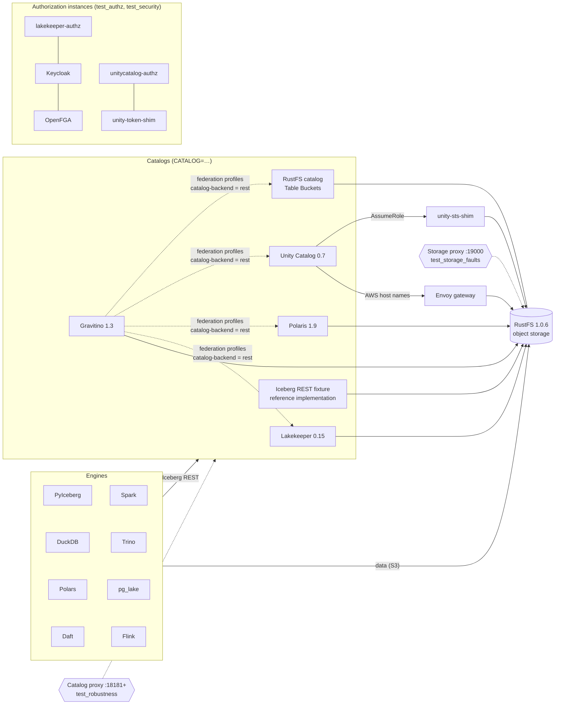
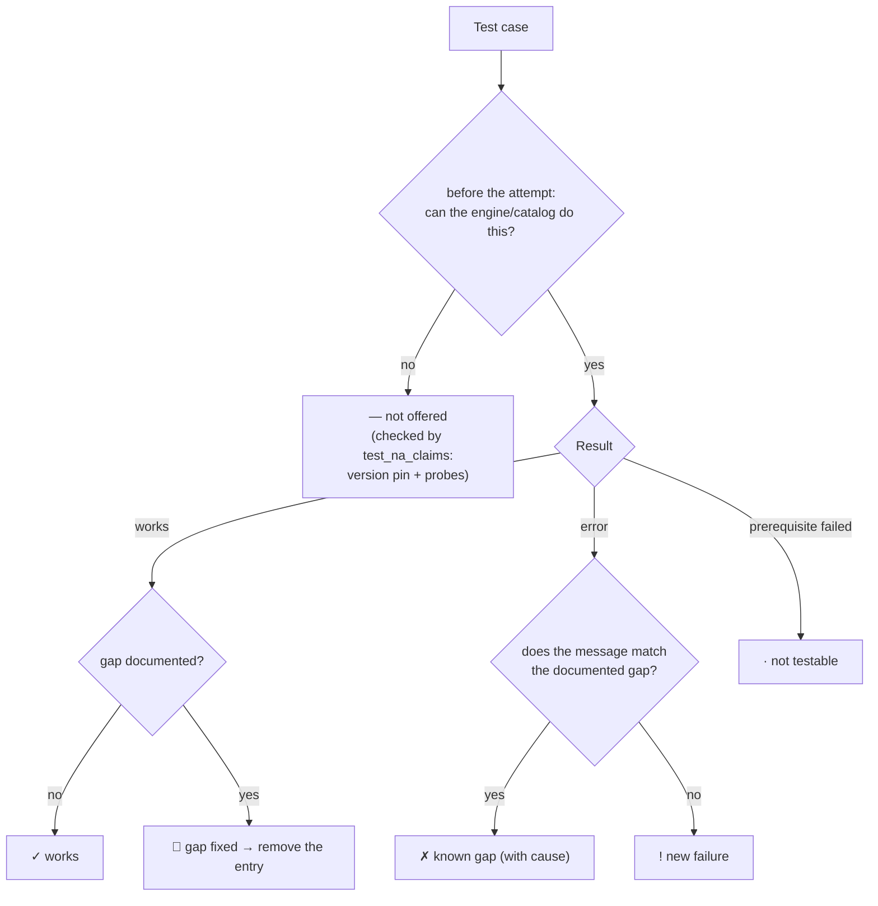
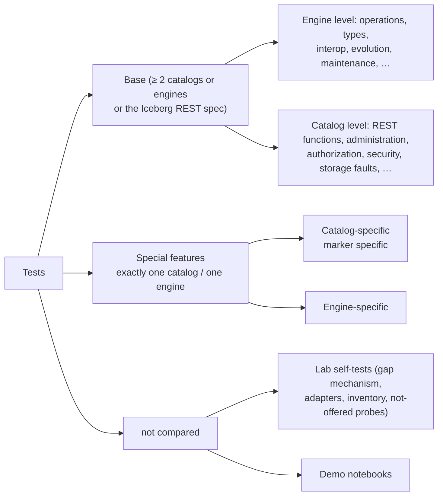

# Iceberg Lab – six REST catalogs × eight engines

A local lab that compares Apache Iceberg **catalogs** and **engines**, with tests as evidence for
every claim about what works and what does not:

- **Catalogs** (Iceberg REST): **Lakekeeper** 0.15, **Apache Polaris** 1.9, the **RustFS catalog**
  built into RustFS (Table Buckets), **Unity Catalog OSS** 0.7, **Apache Gravitino** 1.3 and the
  **Apache Iceberg REST fixture** (the reference implementation, `CATALOG=reference`). Select with
  `CATALOG=…`; the default is Lakekeeper.
- **Federation**: Gravitino in front of each of the other catalogs (`CATALOG=gravitino_lakekeeper`,
  `gravitino_polaris`, `gravitino_unity`, `gravitino_rustfs`) runs the same suite through
  Gravitino, plus checks that both sides see each other's changes
  (`tests/catalog/test_gravitino_fronting.py`).
- **Engines**: PyIceberg, DuckDB, Polars, Daft, Spark, Trino, Postgres/pg_lake and Apache Flink.
- **Storage**: RustFS (S3-compatible) for all catalogs.

**Base tests** run identically on every catalog and for every engine and feed the comparison;
**special features** of single catalogs or engines are tested and reported separately
(`docs/test-architecture.md`). Every run writes a report (`reports/`) with a manifest of the
versions it ran with, and the latest full run per catalog is kept as reference in `results/`;
known gaps are documented with their exact error message, everything else shows up as a new
failure. Bugs found are in `docs/findings.md`; drafts of bug reports are in `docs/bug-reports/`.
Example notebooks show every engine on every catalog. Python environment managed with **uv**.

## Overview in pictures

**Lab layout** – eight engines talk Iceberg REST to one of the six catalogs; all of them store in
RustFS. The fault proxies run inside the test process and are only put in between for their
tests.



**How a test result comes about** – a known gap only counts with exactly the documented error
message; changes after an update show up in both directions.



**Test classification** – only the base tests feed the comparison.



## Getting started

1. Open the folder in VS Code → *Reopen in Container*.
   - `postCreateCommand`: `uv sync --all-groups`
   - `postStartCommand`: `uv run python -m iceberg_lab.bootstrap` (bucket, Lakekeeper bootstrap, warehouses)
2. Optional engines (from `.devcontainer/`, on the host or in a container with Docker access):
   ```bash
   docker compose --profile trino  up -d trino                # ~1–2 GB RAM
   docker compose --profile pglake up -d --build pg-lake      # Postgres 19 + pg_lake 3.7 (built from source, first build ~1.5-2 h)
   docker compose --profile flink  up -d --build flink        # Flink 2.3 + SQL Gateway (~2.5 GB RAM)
   docker compose --profile authz  up -d lakekeeper-authz     # second Lakekeeper with Keycloak + OpenFGA (~1 GB)
   docker compose --profile polaris up -d polaris             # Apache Polaris 1.9 (CATALOG=polaris)
   scripts/build_polaris_console.sh                           # once: build the Polaris Console image (none is published)
   docker compose --profile polaris up -d polaris-console     # Polaris Console (web UI), localhost:8184
   docker compose --profile unity  up -d                      # Unity Catalog 0.7 + gateway, shims, authz instance, Unity UI (CATALOG=unity)
   docker compose --profile reference up -d reference         # Apache Iceberg REST fixture (CATALOG=reference)
   docker compose --profile gravitino up -d gravitino         # Apache Gravitino 1.3 + web UI (CATALOG=gravitino;
                                                              #   in front of the others: CATALOG=gravitino_<backend>)
   ```
   After a lab restart: Polaris keeps nothing (`CATALOG=polaris uv run python -m
   iceberg_lab.bootstrap`); OpenFGA keeps its tuples in Postgres; `scripts/keycloak_audiences.py`
   restores the Keycloak clients and scopes.
3. Tests:
   ```bash
   uv run pytest -m offline           # lab self-tests only: no catalog, no engine (seconds)
   uv run pytest -m "not slow"        # without Spark/Trino/notebooks (fast)
   uv run pytest                      # everything that runs (engines that are not started are skipped)
   uv run pytest -k duckdb            # one engine
   uv run pytest tests/engines/test_types.py  # type matrix (~10–15 min with all engines)
   CATALOG=polaris scripts/run_all.sh # full run on one catalog (cleans up first, ~1–2 h)
   scripts/run_parallel.sh            # full runs of all catalogs, 2 at a time (PARALLEL=n)
   CATALOG=unity scripts/smoke.sh     # quick cross-section (~10 min), own report reports/smoke/
   scripts/rerun.sh tests/x.py        # rerun tests on all catalogs, merged into their full runs
   scripts/rerun.sh --flaky 5         # every intermittent gap 5 times (FIXED? when gone)
   git diff results/                  # after a full run: which tests changed against the reference
   scripts/systemd/install.sh         # on the host: rerun the intermittent gaps every Sunday
   ```
   Cloud catalogs (Snowflake Open Catalog and Horizon, Databricks Unity Catalog): see
   [docs/cloud-catalogs.md](docs/cloud-catalogs.md).
4. Notebooks: open `notebooks/` directly in VS Code (kernel: `/home/vscode/.venv`) or
   `uv run jupyter lab --ip 0.0.0.0` → port 8888. Pick the catalog with the environment variable
   at startup, e.g. `CATALOG=unity uv run jupyter lab --ip 0.0.0.0` (default Lakekeeper).

> 15 GB RAM is enough, but not for everything at once: Spark + Trino + the type matrix + a parallel
> compile job crashed WSL twice. Start heavy runs one after another; on such a machine run
> `PARALLEL=1 scripts/run_parallel.sh` (each catalog in turn).

## Where to find what

| Document | Content |
|---|---|
| [docs/setup.md](docs/setup.md) | pg_lake, Flink, authentication per catalog, the other catalogs, services, pinned versions, access modes |
| [docs/tests.md](docs/tests.md) | the engine comparison, layout, every test file, how to read a result, lab adjustments that affect results |
| [docs/findings.md](docs/findings.md) | gaps and bugs found, by catalog and engine |
| [docs/test-architecture.md](docs/test-architecture.md) | base tests vs. special features, themes, what is still open, feature inventory |
| [docs/bug-reports/](docs/bug-reports/) | drafts of bug reports (not filed) |
| [results/](results/) | versioned reference results of the latest full run per catalog (`git diff results/`) |
| [CHANGELOG.md](CHANGELOG.md) | what changed in the lab and what each run found, by date |
| Dashboard | `scripts/dashboard/` - overview of all results (built from `reports/` after a full run) |

