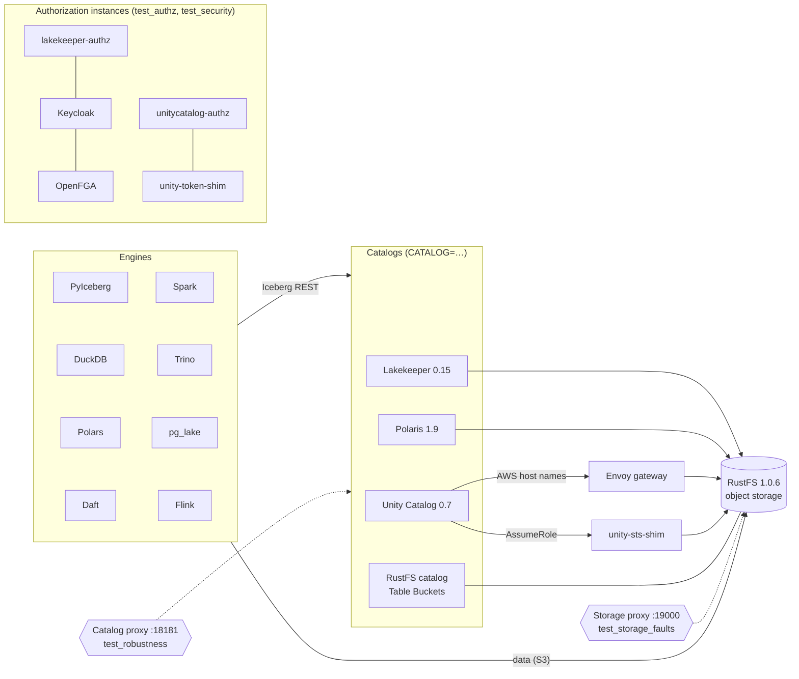
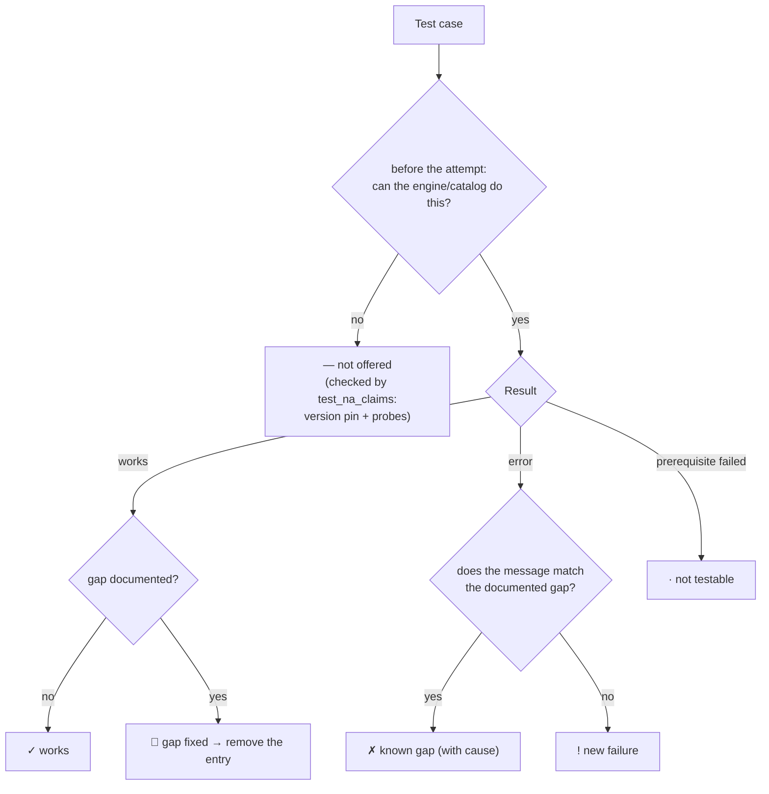
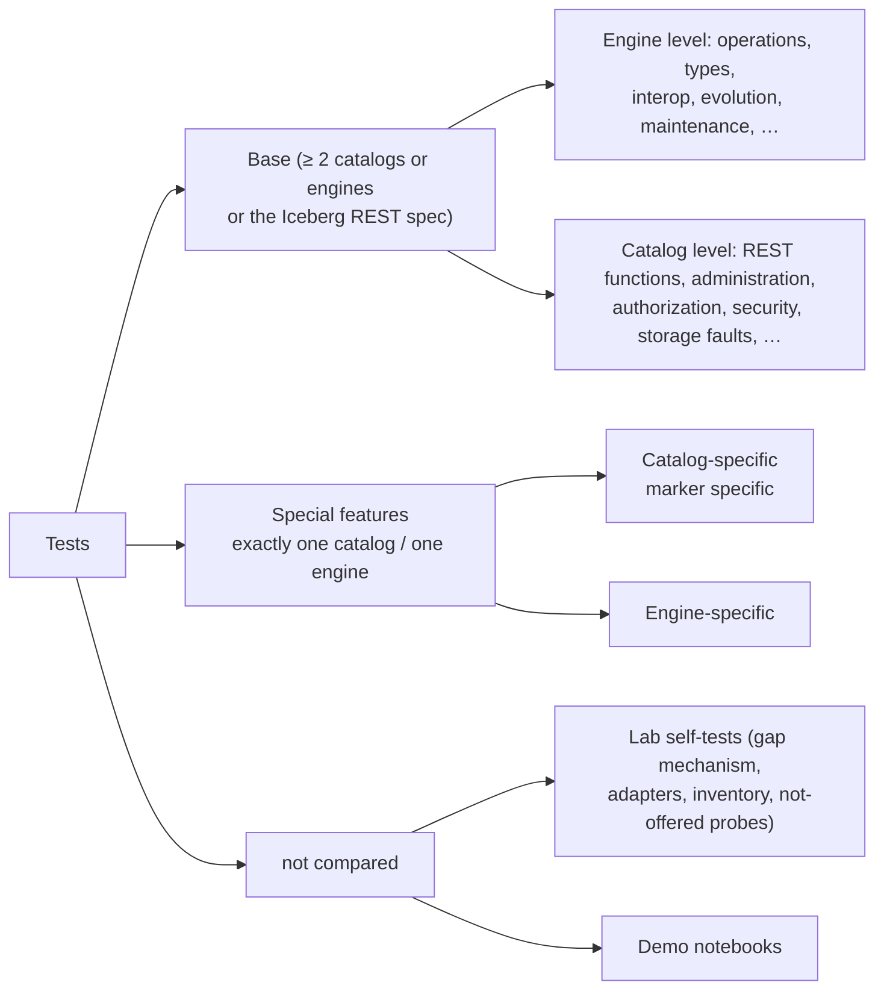

# Iceberg Lab – four REST catalogs × eight engines

A local lab that compares Apache Iceberg **catalogs** and **engines**, with tests as evidence for
every claim about what works and what does not:

- **Catalogs** (Iceberg REST): **Lakekeeper** 0.15, **Apache Polaris** 1.9, the **RustFS catalog**
  built into RustFS (Table Buckets) and **Unity Catalog OSS** 0.7. Select with `CATALOG=…`;
  the default is Lakekeeper.
- **Engines**: PyIceberg, DuckDB, Polars, Daft, Spark, Trino, Postgres/pg_lake and Apache Flink.
- **Storage**: RustFS (S3-compatible) for all catalogs.

**Base tests** run identically on every catalog and for every engine and feed the comparison;
**special features** of single catalogs or engines are tested and reported separately
(`docs/test-architecture.md`). Every run writes a report (`reports/`); known gaps are documented
with their exact error message, everything else shows up as a new failure. Bugs found are listed
below; drafts of bug reports are in `docs/bug-reports/`. Example notebooks show every engine on
every catalog. Python environment managed with **uv**.

## Overview in pictures

**Lab layout** – eight engines talk Iceberg REST to one of the four catalogs; all of them store in
RustFS. The fault proxies run inside the test process and are only put in between for their
tests.



**How a test result comes about** – a known gap only counts with exactly the documented error
message; changes after an update show up in both directions.



**Test classification** – only the base tests feed the comparison.



## Getting started

1. Open the folder in VS Code → *Reopen in Container*.
   - `postCreateCommand`: `uv sync --all-groups`
   - `postStartCommand`: `uv run python -m iceberg_lab.bootstrap` (bucket, Lakekeeper bootstrap, warehouses)
2. Optional engines (from `.devcontainer/`, on the host or in a container with Docker access):
   ```bash
   docker compose --profile trino  up -d trino                # ~1–2 GB RAM
   docker compose --profile pglake up -d --build pg-lake      # Postgres 19 + pg_lake 3.7 (built from source, first build ~1.5-2 h)
   docker compose --profile flink  up -d --build flink        # Flink 2.3 + SQL Gateway (~2.5 GB RAM)
   docker compose --profile authz  up -d lakekeeper-authz     # second Lakekeeper with Keycloak + OpenFGA (~1 GB)
   docker compose --profile polaris up -d polaris             # Apache Polaris 1.9 (CATALOG=polaris)
   scripts/build_polaris_console.sh                           # once: build the Polaris Console image (none is published)
   docker compose --profile polaris up -d polaris-console     # Polaris Console (web UI), localhost:8184
   docker compose --profile unity  up -d                      # Unity Catalog 0.7 + gateway, shims, authz instance, Unity UI (CATALOG=unity)
   ```
   After a lab restart: Polaris keeps nothing (`CATALOG=polaris uv run python -m
   iceberg_lab.bootstrap`), neither does OpenFGA (run `lakekeeper-authz-migrate` again, then start
   `lakekeeper-authz`); `scripts/keycloak_audiences.py` restores the Keycloak clients and scopes.
3. Tests:
   ```bash
   uv run pytest -m "not slow"        # without Spark/Trino/notebooks (fast)
   uv run pytest                      # everything that runs (engines that are not started are skipped)
   uv run pytest -k duckdb            # one engine
   uv run pytest tests/engines/test_types.py  # type matrix (~10–15 min with all engines)
   CATALOG=polaris scripts/run_all.sh # full run on one catalog (cleans up first, ~1–3 h)
   ```
4. Notebooks: open `notebooks/` directly in VS Code (kernel: `/home/vscode/.venv`) or
   `uv run jupyter lab --ip 0.0.0.0` → port 8888. Pick the catalog with the environment variable
   at startup, e.g. `CATALOG=unity uv run jupyter lab --ip 0.0.0.0` (default Lakekeeper).

> 15 GB RAM is enough, but not for everything at once: Spark + Trino + the type matrix + a parallel
> compile job crashed WSL twice. Start heavy runs one after another.

### pg_lake

pg_lake (Snowflake-Labs) publishes no runnable images – GHCR only has CI build environments, and
its `docker/` setup is a development environment that compiles Postgres 16–19 with assertions.
`pg_lake/Dockerfile` therefore builds pg_lake **v3.7.0** from source on the official image
`postgres:19.0-trixie`: vcpkg (Azure SDK, which pg_lake links statically), then `make install`
(DuckDB 1.5.6 with pg_lake's patches, the extensions, `pgduck_server`); a second stage copies only
the installed files and checks with `ldd` that no shared library is missing. The first build takes
about 1.5–2 hours (DuckDB) with 2 parallel jobs – DuckDB's link step needs ~3 GB RAM per job, so
build it alone. A ccache cache mount makes a rebuild after a later failure quick.

One container, two processes (`pg_lake/entrypoint.sh`): `pgduck_server` (embedded DuckDB, reads and
writes the files in S3) in the background, Postgres in the foreground; they connect through the
socket `/var/run/pgduck/.s.PGSQL.5332`. Two pitfalls are solved there:

- `AWS_EC2_METADATA_DISABLED=true` – otherwise DuckDB's AWS credential chain hangs at startup on the
  EC2 metadata endpoint, `pgduck_server` never opens its socket and Postgres reports
  `could not start query engine`.
- `--memory_limit 2GB` (`PGDUCK_MEMORY_LIMIT`) – DuckDB's default is 80 % of the host RAM.

Lakekeeper and Unity run without authentication here: pg_lake connects with its own option
`rest_auth_type 'none'` (no token). Polaris: its real OAuth2 token endpoint.

### Flink

`flink/Dockerfile` extends `flink:2.3.0-java17` with `iceberg-flink-runtime-2.3` and
`iceberg-aws-bundle` (1.12.0) plus the Hadoop client. One container starts JobManager and
TaskManager (`start-cluster.sh`) and the **SQL Gateway** (`:8083`) in the foreground. PyFlink does
not fit the lab environment (it pins old pyarrow/pandas), so the `FlinkEngine` adapter speaks Flink
SQL through the gateway's REST API: one batch-mode session per adapter, both warehouses as Iceberg
REST catalogs `sts` and `signing` (remote signing works, as with Spark, through the Iceberg Java
code). The gateway's JSON format cannot output `VARIANT` or maps with non-string keys; the metadata
tests cast such columns to `STRING`.

### Authentication and authorization – on all four catalogs

`tests/security/test_authz.py` checks the same scenarios on every catalog (alice: read on
`t_select`, read and write on `t_modify`, nothing on `t_none`; bob: no rights; every engine logs in
as alice and as bob). How users, rights and login are set up per catalog is in
`tests/lab/authz_backends.py`:

| Catalog | Authz instance | Login | Rights |
|---|---|---|---|
| Lakekeeper | second instance `lakekeeper-authz` (profile `authz`) | Keycloak, OAuth client credentials | OpenFGA, per table |
| Polaris | main instance (RBAC always on) | its own token broker: principals `az_alice`/`az_bob` with fixed credentials; plus Keycloak as external identity provider (`mixed`, principal `alice`, token with `scope=polaris`, audience `polaris` required) | catalog role with table privileges |
| RustFS | main instance | IAM users `az-alice`/`az-bob`, SigV4; plus Keycloak via STS `AssumeRoleWithWebIdentity` (clients `rustfs-alice`/`rustfs-bob`, policy from the claim `rustfs_policy`, audience `rustfs` only) | catalog actions per bucket (`admin:GetTable`, `admin:CommitTable`, ...); read/write per table through S3 policies on data and metadata |
| Unity | second instance `unitycatalog-authz` (profile `unity`) | Keycloak → `unity-token-shim` (client credentials with `scope=unity` → Unity token exchange; Unity requires audience `unity`) | `USE CATALOG`/`USE SCHEMA` + `SELECT`/`MODIFY` per table |

Every token names only the audience of the service it is issued for (`src/iceberg_lab/keycloak.py`,
set up with `scripts/keycloak_audiences.py`): Lakekeeper by default, Unity and Polaris through
optional scopes, RustFS through its own clients – RustFS rejects tokens with further audiences.

Beyond single grants, `tests/security/test_rbac.py` checks roles (members, removal, several roles,
a grant on a namespace, a role from the Keycloak token) and `tests/security/test_privileges.py`
checks which privileges each catalog knows (`docs/api/privileges-<catalog>.txt`) and what the
common ones do. In short:

| | Roles | Role from the token | Grant on a namespace | Single privileges (see, list, create, alter, drop, grant on) |
|---|---|---|---|---|
| Lakekeeper | ✓ | ✗ (only with Cedar; the lab uses OpenFGA) | ✓ | all |
| Polaris | ✓ (principal + catalog role) | ✗ (only together with an assignment in Polaris) | ✓ | all |
| RustFS | ✓ (IAM groups) | ✓ (policy claim) | – (data does not live under the namespace) | all except granting on (IAM administration only) |
| Unity | – (no groups) | – | ✓ | create only (everything else is reserved to the owner) |

Trino uses fixed catalog files per catalog and user (`lk_authz_*`, `pol_authz_*`, `rfs_authz_*`,
`uc_authz_*`). What a catalog does not offer (remote signing except on Lakekeeper, vended
credentials on RustFS) is shown as "not offered".

#### Lakekeeper in detail (profile `authz`)

A **second** Lakekeeper (`lakekeeper-authz`, its own database `db-authz`) with OIDC through
**Keycloak** (realm `iceberg`, `authz/keycloak/realm.json`) and authorization through **OpenFGA**
(in-memory – after an OpenFGA restart run `lakekeeper-authz-migrate` again). The main Lakekeeper
stays open; the other tests are not affected. Identities are client-credentials service accounts:
`lab-admin` (bootstrap, warehouses `authz-sts` and `authz-signing`, grants rights), `alice` (receives
rights), `bob` (none). Trino uses the catalogs `lk_authz_alice`/`lk_authz_bob`; pg_lake needs
`scope 'openid'` in its server options (its default `PRINCIPAL_ROLE:ALL` is a Polaris convention that
Keycloak rejects).

#### Unity in detail

`unitycatalog-authz` runs with `server.authorization=enable` (`unity/server-authz.properties`) and
accepts Keycloak as issuer. Unity maps a token to the user whose external ID equals the client ID in
the token. The bootstrap creates `alice` and `bob` through SCIM. `unity/token_shim.py` does the token
exchange, so all engines use plain OAuth client credentials; `lab-admin` gets Unity's own admin token
(from the instance's configuration volume).

### Other catalogs: `CATALOG=polaris|rustfs|unity`

The whole suite can run against another Iceberg REST catalog: `CATALOG=polaris
scripts/run_all.sh` (default: Lakekeeper). All engines take URI, warehouse and login from the
catalog profile in `src/iceberg_lab/config.py`; results go to `reports/polaris/`. The base tests are
identical on all catalogs and for all engines; tests of special features run separately and do not
count in the comparison (`docs/test-architecture.md`).
Before the run, `scripts/cleanup_storage.py` removes the catalog's test leftovers (leftover
`test_*` namespaces, files without a table, older than 3 h): RustFS, Unity and Lakekeeper do not
delete on drop (or only later), and tens of thousands of orphaned objects slow RustFS down until
large read/write tests time out. Without `--apply` it is a dry run; `CLEANUP=0` skips the cleanup.
**Apache Polaris 1.9.0** (profile `polaris`, `docker compose --profile polaris up -d polaris`)
runs on the same RustFS with in-memory persistence; the bootstrap creates the catalog
`polaris_sts` (STS through RustFS, `drop-with-purge` enabled – the Polaris default is off) and gives
the root principal `CATALOG_MANAGE_CONTENT`. What a catalog does not offer (Polaris: remote
signing) shows as "not offered" in the report. The demo notebooks also run against every catalog.
Polaris runs with catalog federation enabled (`ENABLE_CATALOG_FEDERATION`, connection type
`ICEBERG_REST`) so that `test_federation*` can create an external catalog on Lakekeeper.
**RustFS catalog** (`CATALOG=rustfs`, no separate service): the Iceberg REST catalog built into
RustFS ("Table Buckets", `/iceberg`). The bootstrap creates the bucket `labtables` and enables it
(`PUT /iceberg/v1/buckets/labtables`). Login with SigV4; RustFS vends no credentials
(`client-provided-s3-credentials-required`), the engines use their own. The lab's own PyIceberg
(setup, cross-reads) sends the `x-amz-content-sha256` header RustFS requires itself; when PyIceberg,
Polars or Daft is the engine under test, this fix is off (`conftest._pyiceberg_engine_role`).
pg_lake has no SigV4 and shows as "not offered".

**Unity Catalog OSS 0.7.0** (`CATALOG=unity`, profile `unity`: `docker compose --profile unity up -d unitycatalog`):
Iceberg REST under `/api/2.1/unity-catalog/iceberg`, warehouse = Unity catalog `lab`, storage in the
bucket `unitylab`. Unity knows no custom S3/STS endpoint; an Envoy gateway (`unity/envoy.yaml`) takes
over the AWS host names inside the compose network with a local CA, and an STS shim
(`unity/sts_shim.py`) translates Unity's session policies for RustFS (both modelled on Unity's docs
environment). The engines get short-lived credentials from Unity and talk to `rustfs:9000` directly.
pg_lake commits every write through `/transactions/commit`, which Unity does not offer – pg_lake
still reports success; the adapter therefore refuses writes on such catalogs with a clear message,
and `test_pglake.py::test_insert_commits_to_catalog` shows the real behaviour.

For views, all engines give the catalog the same name per catalog profile: `sts` (Lakekeeper),
`psts` (Polaris), `rsts` (RustFS), `usts` (Unity) – Trino catalogs are fixed files
(`trino/catalog/`), and `sts` points at Lakekeeper.

## Services

| Service | Address (in the container / host) | Purpose |
|---|---|---|
| RustFS | `rustfs:9000` / `localhost:9000`, console `:9001` (`rustfsadmin`/`rustfsadmin`) | S3, bucket `warehouse` |
| Lakekeeper | `lakekeeper:8181` – `/catalog`, `/management`, `/ui` | Iceberg REST catalog |
| Postgres | `db:5432` | Lakekeeper metadata |
| Trino *(profile `trino`)* | `trino:8080` | catalogs per catalog: `lk_*` (Lakekeeper), `pol_*` (Polaris), `rfs_*` (RustFS), `uc_*` (Unity); plus `*_proxy` (fault proxy), `*_authz_alice/bob` (authorization) and the view catalogs |
| pg_lake *(profile `pglake`)* | `pg-lake:5432` / `localhost:5433` | Postgres 19 + pg_lake 3.7 + `pgduck_server` |
| Flink *(profile `flink`)* | web UI `flink:8081`, SQL Gateway `flink:8083` | Flink 2.3.0 + Iceberg 1.12.0 |
| Polaris *(profile `polaris`)* | `polaris:8181` / `localhost:8183` – `/api/catalog`, `/api/management` | Apache Polaris 1.9.0 |
| Lakekeeper-authz *(profile `authz`)* | `lakekeeper-authz:8181` / `localhost:8282`, Keycloak `keycloak:8080` / `localhost:30080` | OIDC + OpenFGA |
| Unity Catalog *(profile `unity`)* | `unitycatalog:8080` / `localhost:8380` – `/api/2.1/unity-catalog`, Iceberg REST under `…/iceberg` | Unity Catalog OSS 0.7.0, plus `unity-gateway` (Envoy), `unity-sts-shim` |
| Unity-authz *(profile `unity`)* | `unitycatalog-authz:8080` (compose network only), `unity-token-shim` | authz instance for `test_authz.py` |
| Polaris Console *(profile `polaris`)* | `polaris-console:8080` / `localhost:8184` | Polaris web UI (image from `apache/polaris-tools`, `scripts/build_polaris_console.sh`) |
| Unity UI *(profile `unity`)* | `unity-ui:3000` / `localhost:3000` | Unity web UI (`unitycatalog/unitycatalog-ui`), points at the authz instance |

Versions are pinned (checked 2026-11-17): Lakekeeper `v0.15.1`, Polaris `1.9.0`, Unity Catalog
`v0.7.0`, RustFS `1.0.6`, Trino `484`, Spark `4.1.4` with `iceberg-spark-runtime-4.1_2.13:1.12.0`,
Flink `2.3.0` with `iceberg-flink-runtime-2.3:1.12.0` and Hadoop client `3.5.0`, PyIceberg `0.12.0`,
DuckDB `2.0.0`, Polars `2.1.0`, Daft `0.7.26`, Keycloak `26.8.2`, OpenFGA `v1.22.1`, Envoy `v1.40`
(follows patch releases), Postgres `17.12` (catalog databases) and `19.0` with pg_lake `3.7.0` (built from source). Deliberately not the latest:

| Component | Lab | Latest | Reason |
|---|---|---|---|
| PySpark | 4.1.4 | 4.3.0 | Iceberg 1.12 has no runtime for Spark 4.2+ |
| PyArrow | 25.0.1 | 26.0.1 | Daft 0.7.26 requires < 26 |
| boto3 | 1.43 | 1.44 | s3fs/aiobotocore pin the botocore version |

Whether an engine can do something after an update that its tests skip as "not offered" is
checked by `tests/selftest/test_na_claims.py` (version pin + probes); new endpoints of a catalog are
reported by `tests/selftest/test_feature_inventory.py::test_advertised_endpoints_are_recorded`.

## Access modes: how engines get to the files

Different per catalog: **Lakekeeper** offers both modes as two warehouses (table below),
**Polaris** and **Unity** only vended credentials (Polaris: warehouse `polaris_sts`, Unity: catalog
`lab`, credentials valid for 1 h each), the **RustFS catalog** vends no credentials – the engines
log in with their own S3 keys (SigV4). What a catalog does not offer shows as "not offered" in the
report.

| Warehouse (Lakekeeper) | Engine's S3 access | Security |
|---|---|---|
| `demo-signing` | **Remote signing** – Lakekeeper signs every S3 request | the engine never sees keys; Lakekeeper checks every access |
| `demo-sts` | **Vended credentials** – short-lived STS keys (RustFS `AssumeRole`), restricted to the table path | keys stay valid until they expire, cannot be revoked |

Engines that cannot do remote signing get static RustFS keys on `demo-signing` (DuckDB
`CREATE SECRET`, Trino `lk_signing`, Polars `storage_options`, Daft).

## Engine comparison

Every test run writes `reports/comparison.md` (Lakekeeper; other catalogs in
`reports/<catalog>/`) (overview "works / applicable" per engine and area, plus matrices for
operations, cross-reads, types, type fidelity, access, interop, v3) and `reports/results.json` (raw
data, one entry per test). **Coverage** = works / all cases (not offered and not testable count as
not working), **reliability** = works / offered cases. Only the base tests are compared;
"engine-specific", "catalog-specific" and "lab self-test" are reported separately. Every test
belongs explicitly to one area (`tests/lab/reporting.py`); without an area it shows up as
"unassigned" and is counted.

## Layout

```
.devcontainer/          Dockerfile (Python 3.12, Java 17, uv), docker-compose.yml, devcontainer.json
src/iceberg_lab/        config.py, bootstrap.py, engines.py (adapter per engine), datatypes.py (type catalog v2+v3)
tests/                  see below; one folder per topic, each with its own README
notebooks/              00–09: one example notebook per engine + setup + interop matrix (09 = Flink), for every catalog (`CATALOG=…`)
trino/catalog/          Trino catalogs per catalog profile, warehouse and authz user
unity/                  Unity: Envoy gateway, STS shim, token shim, server(-authz).properties
docs/                   test-architecture.md (base vs. special features), feature-inventory.md (generated),
                        api/ (endpoint lists of the four catalogs), bug-reports/ (drafts, not filed)
scripts/                run_all.sh (full run per catalog), cleanup_storage.py (remove test leftovers)
authz/                  Keycloak realm (fixed service-account IDs) for the authz instances
flink/                  Dockerfile (Flink 2.3 + Iceberg JARs), start-lab.sh (cluster + SQL Gateway)
pg_lake/                Dockerfile (postgres:19.0 + pg_lake 3.7.0 built from source), entrypoint, init SQL
```

Test folders: `tests/lab` (shared modules, no tests), `tests/engines` (engine matrices),
`tests/catalog` (catalog level), `tests/security` (authentication, authorization, security),
`tests/storage` (storage and fault behaviour), `tests/specific` (engine-specific),
`tests/selftest` (lab self-tests), `tests/demos` (notebooks).

| Test file | Content |
|---|---|
| `test_access_delegation.py` | engine × warehouse × read/write with catalog credentials only; STS scope; signer scope |
| `test_interop.py` | every engine writes, every engine reads |
| `test_file_formats.py` | data formats ORC and Avro (besides Parquet): every engine writes into a table with `write.format.default`, the actual file format is checked; every engine reads |
| `test_types.py` | all Iceberg types (v2 + v3) × writer × reader: values (`test_read`) and type fidelity (`test_reader_type`: does the engine report the matching type, e.g. `uuid` instead of `string`?). pg_lake writes with its own Postgres types (composite for structs, `map_type` for maps). Plus `test_read_neutral`: every reader reads a table written by the lab client (PyIceberg) – this shows whether a reader can read a type at all, even where writers fail |
| `test_operations.py` | DDL/DML/evolution/time travel per engine, format v2 and v3; plus merge-on-read DELETE, a transaction with several changes (one commit), an aborted transaction, seeing foreign commits, identifier fields, CREATE on an existing table, filter/aggregation, listing tables; MERGE must be a single commit. Every engine writes its starting data itself (if it cannot, the test failed – no substitute engine); then **every other engine** reads the result back (`test_operation_cross_read`) |
| `test_v3_features.py` | deletion vectors, default values, row lineage |
| `test_maintenance.py` | maintenance per engine, v2 + v3: compact data files and delete files, rewrite manifests, expire snapshots, remove orphan files, DROP deletes files – each checked in the metadata, **directly in RustFS** and by cross-reads of all engines |
| `test_concurrency.py` | concurrent commits: 4 parallel appends per engine, all engines at once on one table, appends during a compaction, DELETE against UPDATE of the same row (isolation), two concurrent upserts of the same new key |
| `test_neutral_source.py` | neutral read source for operations, partitions, evolution and maintenance: Iceberg Java core (the reference implementation, directly through the JVM, without Spark SQL) writes every state once – natively v2 and v3, with position deletes, deletion vectors and equality deletes – then every engine reads. Neutral row fine, matrix cell red → the combination (mostly the writer's files); neutral row red → the reader |
| `test_rbac.py` | roles and inherited grants on all catalogs: a grant to a role reaches every member (and only that table), whoever leaves the role loses access at once, grants of several roles add up without spilling over, a grant on a namespace applies to its tables (also later ones) and not to others. Lakekeeper roles, Polaris principal/catalog roles, RustFS IAM groups; Unity OSS has no roles, RustFS no namespace data grants (both checked on every run) |
| `test_privileges.py` | single privileges: which privileges every catalog knows (`docs/api/privileges-<catalog>.txt`, read from the running images with `scripts/privilege_inventory.py`: Lakekeeper OpenAPI, Polaris/Unity enums, RustFS IAM actions; checked live, image version recorded) and what the common privileges do: see metadata without data, list tables, create, alter, drop, grant on – each positive (allows exactly its action, no more) and negative (refused without the privilege), with a single REST call |
| `test_ui.py` | web UI (each project's official UI): is it served, is it wired to the lab catalog, and does the data API behind it refuse anonymous requests (with a positive control)? Lakekeeper `/ui/` and the RustFS console from the server; Polaris Console (container `polaris-console`, image built from `apache/polaris-tools` with `scripts/build_polaris_console.sh`) and Unity UI (container `unity-ui`, port 3000) as separate containers |
| `test_stock_connection.py` | every engine connects without lab help (default configuration), writes and reads a table – evidence for the connection gaps the lab's helps work around (the only test that runs without them) |
| Lab helps and the run "without help" (`CATALOG=<catalog> LAB_NO_HELP=1 scripts/run_all.sh`) | engines that cannot connect without a sensible workaround get it in every run (`iceberg_lab.config.HELPS`: RustFS – PyIceberg, Polars, Daft, DuckDB); a test that works with it counts as working. The run without help repeats only these engines' tests without the workaround; own report `reports/<catalog>-nohelp/`, shown next to the comparison in the dashboard (grey columns "without help") and in `docs/lab-helps.md` (`scripts/lab_helps_doc.py`), not counted |
| `test_branch_isolation.py` | every engine reads `main` while a branch has a newer commit (must not show it), and writes to `main` without changing the branch |
| `test_recreate_session.py` | an engine has the table open, it is dropped and re-created with the same name: does the engine then read and write the new table? |
| `test_file_spec.py` | written files per specification: Avro metadata of every manifest (`partition-spec`, `format-version`, `content`, ...; `schema-id` separately), field IDs in every Parquet file – per engine |
| `test_sts_scope.py` | reach of a table's STS keys (directly with boto3): write/delete/list only in the own table, not in table B, the bucket root, another warehouse, foreign buckets; expiry time, renewal through `/credentials`, tampered token |
| `test_evolution.py` | partition transforms (identity, bucket, truncate, year/month/day/hour) × writer × reader with filters, schema evolution (rename/add/drop/widen) and partition evolution across engines |
| `test_views.py` | create views and read foreign views (dialects); dependency on the catalog name |
| `test_namespaces.py` | namespaces per engine: create, nest, properties, do not drop non-empty ones, drop |
| `test_statistics.py` | compute table statistics (Puffin/NDV) and have Trino use them, partition statistics |
| `test_robustness.py` | fault proxy in front of the catalog (all four): lost commit response, 503 on commit, catalog gone – with an integrity check of the table |
| `test_storage_faults.py` | storage faults under the catalog (proxy in front of RustFS, own warehouse/catalog): metadata writes with 503, without response, slow; storage gone while loading; STS gone while vending – error instead of hanging, table intact, catalog recovers (Lakekeeper, Polaris; RustFS/Unity not testable) |
| `test_rustfs.py` | object storage: multipart upload, range reads, bulk delete, listing over 1000 objects, consistency (directly with boto3); plus per engine one large table (1.5 M rows, ~60 MB) written and read by all engines |
| `test_transactions.py` | transactions over two tables (DuckDB/pg_lake `BEGIN…COMMIT`, Flink `STATEMENT SET`, Trino): one atomic `/transactions/commit`? Does A stay unchanged when B's commit fails? |
| `test_wap.py` | write-audit-publish: write to a branch, check, publish to `main` |
| `test_incremental.py` | incremental reads, changelog, streaming writes and reads (Flink, Spark) |
| `test_sts_expiry.py` | *(marker `long`)* do all engines keep reading with the same object/session after the vended credentials expired? Lakekeeper 900 s (~16 min wait), Polaris and Unity 1 h (~62 min; not configurable per catalog there), RustFS vends no credentials |
| `test_layout.py` | sort order (checked physically in every Parquet file) and target file size per writer |
| `test_performance.py` | run times: write 1 M rows, full scan, selective query – `reports/performance.md` |
| `test_authz.py` | on all four catalogs: anonymous refused, refused without a grant, a read grant reads but does not write (vended credentials read-only, signer refuses PUT), a table without a grant stays closed, write grant, revoking takes effect; every engine as alice/bob (`tests/lab/authz_backends.py`); refusal only with an authorization error (401/403, "not found" only on Lakekeeper, which hides objects) and only for an existing table; metadata of a table without a grant |
| `test_security.py` | security on all catalogs: forged/tampered/expired/foreign tokens and SigV4 signatures (Keycloak cases on all four: directly, through the token exchange, through Polaris' `mixed` mode and through RustFS STS), rights of a Keycloak identity on RustFS, token lifetime, escaping through the storage location (same/inner/outer location, moving the location, registering foreign metadata, registering metadata outside the allowed locations, `write.data.path`), secrets in responses, no storage keys in view responses, no secrets in Trino's query details, revealing error messages, dangerous names, privilege escalation (granting yourself rights, dropping/renaming/creating as a reader) |
| `test_rest_conformance.py` | REST conformance (raw REST, no client in between): every endpoint of the specification with a valid request (works / not offered / broken, matched against `/v1/config`), error documents, HEAD 204, missing parent, `snapshots=refs`, invalid `snapshots` value, missing metadata file – overview in `docs/rest-conformance.md` |
| `test_idp_outage.py` | outage of the token endpoint (proxy in front, no container is stopped), PyIceberg and Spark: a running session keeps working, a new session fails fast and recognisably, then recovery |
| `test_storage_s3.py` | the storage under all catalogs (RustFS S3 API against AWS behaviour): checksums, conditional writes, multipart error codes, STS session policies (prefix, deny, wildcards, duration) |
| `test_catalog_features.py` | catalog functions, the same list for every catalog (a missing one shows as "not offered"). **Base** (REST specification or ≥2 catalogs): register a table from a foreign catalog, rename across namespaces, drop a namespace after a rename, metrics report, `/credentials`, pagination, ETag/304, idempotency key, remote signing, generic tables (Polaris, Unity), sync with externally written metadata, functions in the catalog (Lakekeeper, Unity). **Special features** (marker `specific`, not in the comparison) – Lakekeeper: trash bin + undrop, protection, tags, warehouse statistics, table search, move namespace, format-version policy, storage validation, permission check, projects, maintenance mode, endpoint statistics, task queue, "managed by", unregistering tables; Polaris: policies with inheritance, federation to Lakekeeper (direct and through a proxy without compression), OpenLineage; RustFS: enable/disable table buckets, unknown bucket, second endpoint `/_iceberg/v1`, table maintenance, refs API, metadata pointer, table management, backup; Unity: volumes (write/read with temporary credentials), functions, ML models, temporary path credentials, schema API. Authorization on all catalogs: `test_authz.py` |
| `test_engine_inventory.py` | lab self-test: what every engine offers for Iceberg (functions, procedures, table properties, API methods), read live and compared with `docs/api/engine-<engine>.txt` – new or removed functions after an update stand out; overview `docs/engine-inventory.md` |
| `test_catalog_admin.py` | catalog administration as a base on all catalogs (adapter per catalog): create, list, use, drop a warehouse/catalog; rename/alter; disable and enable; change storage access; manage users; server info; background tasks |
| `test_feature_inventory.py` | lab self-test: every endpoint of the four catalogs (`docs/api/`) belongs to exactly one capability, every capability has a test, base capabilities have a test for all catalogs, `docs/feature-inventory.md` is up to date; ✓ described and implemented, ◐ described but not implemented (backed by a known gap) |
| `test_lab_selftest.py`, `test_lab_adapters.py` | lab self-tests: the gap mechanism hides nothing (wrong error message, a rule outside its engine, a notebook limit without expectation); the token adapter and STS adapter for Unity open and close nothing by themselves |
| `test_scan_planning.py` | capability tests: server-side scan planning / row and column security |
| `test_pyiceberg.py`, `test_duckdb.py`, `test_spark.py`, `test_dataframes.py`, `test_flink.py` | engine-specific (not in the comparison): only what no base matrix covers – PyIceberg partition pruning and upsert after a rename, DuckDB three-part schema name, Spark PURGE on Lakekeeper, Polars lazy API, Flink join across two warehouses |
| `test_pglake.py` | pg_lake (engine-specific): extension, attaching foreign tables read-only and following their commits, joins with heap tables, silent success on INSERT and on a refused CREATE |
| `test_notebooks.py` | runs all notebooks on the chosen catalog and checks selected outputs (regex in the cell metadata `lab.expect` / `lab.expect_not`, overridable per catalog with `expect_<catalog>`; a notebook a catalog cannot do at all carries a known gap in the notebook metadata). Area "demo notebooks", not in the comparison |

### What does not work right now – how to read the report

Every failure shows as **FAILED**. At the end of every run there is a section
`iceberg lab: failure overview` with two lists:

- **NEW / unexpected failures** – everything that is not documented: new bugs, a broken setup.
- **known gaps reproduced** – documented gaps (`KNOWN_GAPS` tables in the test files), grouped by
  cause with a count. The error message reads `[known gap] <cause>`.

A known gap only counts if **exactly the documented error** occurs (a regex on the error message).
If the same test fails differently, it shows up as a new failure – a gap therefore cannot hide
another bug.

**Fixed gaps stand out:** if a documented gap no longer occurs (e.g. after an engine upgrade), the
test is **FAILED** with `[gap fixed] … remove the KNOWN_GAPS entry` and listed in the section
**FIXED gaps** – in both modes. Then delete the entry from the test file's `KNOWN_GAPS` table; from
then on the case is tested normally. Exception: intermittent gaps (`flaky=True`, e.g. the signing
403) – a run without them does not mean "fixed"; they are only listed under "intermittent gaps not
reproduced this run".

| Result | Meaning |
|---|---|
| `PASSED` | works |
| `FAILED` … `[known gap] …` | does not work, cause known and documented |
| `FAILED` … `[gap fixed] …` | **works now** – the documented gap no longer occurs, remove the entry |
| `FAILED` (without label) | does not work, **new/unexpected** |
| `SKIPPED` | not applicable: the engine has no API/type for it, the engine is not running, or the table could not be written at all (the error is then reported at the write test) |

Options:

```bash
KNOWN_GAPS=xfail uv run pytest            # known gaps as XFAIL -> green run, only new failures are red
REQUIRE_ENGINES=trino,spark uv run pytest # a missing engine is an error instead of a skip
REQUIRE_ENGINES=all uv run pytest
```

### Lab adjustments that affect results

These settings deliberately differ from the defaults. Without them, failures would occur that are
caused by the lab configuration, not by the engine – but whoever uses the defaults runs into exactly
those:

- Memory limits per container (Trino 3 GB, Flink 4 GB, pg_lake 3 GB): Trino's JVM takes 80 % of
  the container memory – without a limit 80 % of the whole host; then the OOM killer ends other JVMs
  (observed: the Spark driver and the Flink TaskManager died in the middle of a run).
- pg_lake: `max_worker_processes=32` (the default of 8 is not enough for 4 parallel writers).
- Flink: TaskManager 2560 MB with 512 MB task off-heap (with 1536 MB `OutOfMemoryError: Direct
  buffer memory` when reading large DuckDB files).
- Spark delete compaction: `use-starting-sequence-number=false` + `rewrite_position_delete_files`
  (otherwise the v2 position delete file stays); orphan cleanup through the Java action with
  `usePrefixListing(true)` (the SQL procedure refuses < 24 h, the Hadoop listing does not know
  `s3://`).
- View test: all engines give the catalog the same name (`sts`, on Polaris/RustFS/Unity
  `psts`/`rsts`/`usts`; Trino catalog file or DuckDB alias) – views store the creator's catalog name.
- pg_lake with Keycloak: server option `scope 'openid'`.
- Keycloak: tokens per service (audience), Polaris in mode `mixed`, RustFS with an OIDC provider
  (`RUSTFS_IDENTITY_OPENID_*`, `RUSTFS_OUTBOUND_ALLOW_ORIGINS=http://keycloak:8080` – otherwise
  RustFS blocks the private address), Unity with `server.audiences=unity`.
- Trino: `iceberg.rest-catalog.nested-namespace-enabled=true`.
- Read matrices (types, cross-reads, evolution, maintenance, interop, v3, file formats): Spark
  drops its table cache before reading (`REFRESH TABLE`, `Engine.refresh`) so that the 30 s cache
  cannot hide data loss. The cache behaviour itself is checked by `sees_external_commit`
  (`test_operations.py`) and Spark writing with a stale spec (`test_evolution.py`).

Dependent tests (cross-reads, reading foreign types/partitions/views) are skipped if their
prerequisite failed – "not testable" in the report; the failure itself is reported at the
prerequisite. A test that reports "not offered" decides so before the attempt; any error during the
attempt itself is a failure. Refusal tests (authorization, non-empty namespaces, catalog gone,
rejected commit) only accept matching error messages, and every write ban has a counter-check over
the same write path.

## Gaps and bugs found (as of the pinned versions)

**Scope of the catalogs**: by capability (feature inventory, 53 in total) described in the API:
Lakekeeper 38, Polaris 22, Unity 20, RustFS 16 – of which also implemented by the server 35, 21,
20, 16 (Lakekeeper describes scan planning, functions and unregister but answers 404; Polaris remote
signing with 501). With 178 endpoints, Lakekeeper's API is more than twice as large as Polaris' (76)
– mostly because of finer-grained administration; on the Iceberg REST standard both are close
(35 to 29). Endpoint counts are therefore no measure for comparison (details:
`docs/test-architecture.md`, "API size").

**Catalogs compared** (per catalog only what the others do not have; evidence in the `KNOWN_GAPS`
of the test files and the central rules in `tests/conftest.py`)
- **All four**: no server-side scan planning (`/plan` not offered), no row/column security, no
  `read-restrictions` in `loadTable`.
- **Lakekeeper 0.15**: hides objects without a grant (answers "does not exist" instead of 403);
  rejects `geometry`/`geography` (422) and – new in 0.15 – partition fields with both `source-id`
  and `source-ids` (affects pg_lake, see below); describes `functions` and `unregister` in the API
  but answers 404; the namespace properties response lacks the field `missing` (PyIceberg fails);
  unknown paths and disallowed methods with an empty body instead of an Iceberg error document
  (404/405); accepts any value for `snapshots` (spec: `all`/`refs`).
- **Polaris 1.9**: remote signing is in the API but answers 501; no moving tables into another
  namespace (1.7 could); direct federation fails on Brotli (native module missing in the image,
  `docs/bug-reports/07`; without compression through a proxy it works); `/transactions/commit`
  requires `TABLE_FULL_METADATA`. More below under "Polaris 1.9".
- **RustFS catalog 1.0.5/1.0.6**: no format v3 (406); no DROP with purge (406), and clients may not
  delete table files themselves (403) – Spark/Trino DROP fails; catalog rights only per bucket, not
  per table – metadata of every table visible to every catalog user; requires
  `x-amz-content-sha256` on every signed POST (PyIceberg, Polars, Daft fail; the lab fixes this only
  for its own client); DuckDB cannot attach SigV4 catalogs outside AWS; a rename leaves an invisible
  entry behind (the namespace can no longer be dropped); `register`, sync and rollback only within
  its own table layout; table buckets can be neither disabled nor deleted after use; several
  endpoints answer 501; rejects views from Spark and Flink (field ID 0); Flink's first upsert into
  an empty table fails.
- **Unity Catalog OSS 0.7**: no `/transactions/commit` (no multi-table transaction; pg_lake silently
  loses every write); views readable only, not creatable; no types `time`, `timestamp_ns`,
  `timestamptz_ns`, `unknown`, `geometry`/`geography` (400 on create; `variant` works); fixed
  hierarchy without nested namespaces; rename only within the same namespace; ignores `pageSize`;
  answers `ns.t.snapshots` with NoSuchNamespace instead of NoSuchTable – Spark and Flink therefore
  find no metadata tables, branches and tags; deletes the files of dropped tables only after 7 days;
  SCIM DELETE only deactivates users.

**Access and remote signing**
- Only **PyIceberg**, **Spark** and **Flink** can do remote signing. DuckDB, Daft, the Polars reader
  and Trino cannot.
- **Remote signing with PyIceberg is intermittently unstable (cause found):** about 1–10 % of the
  commits on `demo-signing` fail with 403. The reason is a **race condition in PyIceberg**
  (`pyiceberg/io/fsspec.py`, `_s3`): fsspec returns a shared, cached S3FileSystem instance, and
  every new FileIO unregisters and re-registers the signer on it – from any thread. Requests signed
  exactly in that window (under 2 ms) go out **unsigned**; RustFS logs them as
  `account: <anonymous>`. Lakekeeper and RustFS are not to blame (0 errors in 9000 locally signed
  requests and 3000 signed by Lakekeeper). Spark is not affected (0/30). Workaround until a fix:
  `demo-sts` instead of remote signing.
- The remote signer checks permissions, not the table ID in the signer URL: without authz it also
  signs paths of other tables (paths outside every table are rejected).
- Lakekeeper v0.15 rejects partition fields with `source-id` **and** `source-ids` (422, "mutually
  exclusive"; v0.14 accepted them). pg_lake sends both and ignores the rejection: **every
  partitioned pg_lake table and every partition evolution fails** – with misleading follow-up errors
  (404 `NoSuchTableException`, `partition spec 1 not found for manifest`).

**PyIceberg 0.12** (also affects Polars/Daft when writing)
- supports v3 **only partly**: **creating and reading** v3 tables (incl. deletion vectors,
  `initial-default`, ns timestamps) and **changing metadata** (schema, branches/tags, rename) works.
  **Writing data into v3 tables** (append/overwrite/delete/upsert) does not: in 0.12.0 – the current
  version – `write_manifest` and `write_manifest_list` implement only v1 and v2
  (`Cannot write manifest for table version: 3`). Polars and Daft write through PyIceberg and
  inherit this.
- does not read **position deletes from Trino** (`DeltaLengthByteArrayDecoder`).
- `upsert` after `rename_column` fails (compares against the old column names).
- `NULL` in `list<struct>` becomes `[]` on write and read.
- does not know `variant` (tables with a variant cannot be loaded).

**Others**
- DuckDB writes `fixed[n]` as variable `binary` → PyIceberg/Spark reject it.
- DuckDB v3 manifests have no partition summaries → the `manifests` metadata table crashes in Trino
  (and Spark for tables created by PyIceberg).
- After every data-changing operation DuckDB and Spark read back (`cross_check` in
  `test_operations.py`): if an engine writes files only it can read, this stands out.
- Daft does not read DuckDB's nested Parquet lists and maps (two different errors) – this also
  affects pg_lake, which writes its files through `pgduck_server` (DuckDB).
- Daft does not apply v3 deletion vectors (reads Puffin as Parquet) and ignores `initial-default`.
- Polars: no `uuid`/`fixed`, `time` is ns-precise (Iceberg: µs).
- Spark 4.1: no `time`, no ns timestamps. Trino 484: reads `unknown` (since 484), does not write it;
  no branch creation, no atomic overwrite (Iceberg writes only in autocommit).
- DuckDB 2.0: `iceberg_rewrite_data_files` (compaction) not yet for v3.

**pg_lake 3.6**
- no `MERGE`, no rename of Iceberg tables in the REST catalog.
- does not read v3 deletion vectors or the types `unknown`, `variant`, `timestamptz_ns`;
  `timestamp_ns` is truncated to microseconds (Postgres precision).
- refuses tables with `initial-default`.
- compaction only with `VACUUM (FULL)` – a plain `VACUUM` deliberately leaves small files.
- `VACUUM` with `max_snapshot_age = 0` does not expire reliably (intermittent, two symptoms): the
  old snapshot stays in the metadata, or it disappears but its data file stays in storage – even
  after another `VACUUM` and `lake_engine.flush_deletion_queue()`.

**Flink 2.3 / Iceberg 1.12**
- no `DELETE`/`UPDATE` (the sink does not implement `SupportsRowLevelDelete/Update`) and no `MERGE`
  statement; Flink's substitute is the upsert (primary key + `write.upsert.enabled`), which writes
  **equality deletes** – which **PyIceberg, Polars and Daft cannot read** (DuckDB, Spark, Trino,
  pg_lake can).
- no procedures (`getProcedure is not implemented for class FlinkCatalog`): no rollback, no
  compaction, no expire through SQL (only the Java API `TableMaintenance`); tags and partition
  evolution have no SQL syntax. Branches work through `OPTIONS('branch'=...)`.
- `TIME` is truncated to seconds on write and to milliseconds on read (Iceberg: µs); `unknown` and
  `variant` cannot be written, `variant` cannot be read through the gateway, `uuid` shows as
  `BINARY(16)`.
- ignores v3 `initial-default` (returns `NULL`).

**Maintenance**
- PyIceberg 0.12: `expire_snapshots` removes snapshots only from the metadata – data, manifest and
  manifest list files stay in storage.
- Lakekeeper deletes files on DROP only with `purgeRequested=true`: PyIceberg `purge_table`, Spark,
  Trino, pg_lake and Flink do that; **DuckDB's `DROP TABLE` does not** (files stay).
- DuckDB: `iceberg_rewrite_data_files` leaves position delete files behind, cannot do v3 and does
  not retry after a commit conflict (409) – with concurrent appends it fails.
- pg_lake: `VACUUM` does not remove foreign orphan files (only those it tracks itself).
- Spark's SQL procedure `remove_orphan_files` refuses intervals under 24 h; the Java action
  (`deleteOrphanFiles().usePrefixListing(true)`) works.
- **pg_lake** rejects v3 tables whose manifests still list a removed deletion vector (status
  DELETED) – i.e. every v3 table after a DV compaction by Spark/Trino.

**Concurrency and robustness**
- **DuckDB: data corruption** – if the response to a commit is lost (the catalog accepted it),
  DuckDB deletes the commit's files; the current snapshot then points to a missing manifest list
  (reproduced on Lakekeeper, Polaris and Unity; on RustFS DuckDB cannot connect).
- DuckDB does not retry commits after a conflict (409) (intermittent, depending on timing).
- All other engines: parallel appends are retried, DELETE against UPDATE is serializable, lost
  responses do not lead to duplicate rows.

**Evolution, views, namespaces**
- **Trino returns wrong results**: with `day(ts)` partitioning and the filter `ts < <day boundary>`,
  the row with `ts = NULL` is included if the files have no `null_value_counts` (pg_lake writes
  none). One second later, with `month(ts)` or `>=`, the result is right.
- Fixed with Iceberg 1.12: Spark's vectorized reader crashed after `int → long` on Parquet files
  written by DuckDB (`ClassCastException BigIntVector → IntVector`).
- Spark caches tables (`cache-enabled=true`, 30 s): it sees changes of other engines (renamed
  column, new partition spec) only afterwards – until then it writes with the old spec.
- Views: Trino and DuckDB only run views in their own dialect, Spark also foreign ones; Flink 2.3
  creates and reads views (Flink 2.1 could do neither). Views store the creator's catalog name
  (`default-catalog`) – portable only if all engines give the catalog the same name (here `sts` or
  `psts`/`rsts`/`usts`).
- DuckDB: `CREATE SCHEMA lk."a"."b"` silently creates a top-level namespace `b` (correct:
  `lk."a.b"`). Lakekeeper's namespace properties response lacks the field `missing` that PyIceberg
  0.12 expects (Polaris sends it, there it works). Flink knows no nested namespaces.
- Statistics: Spark (`compute_table_stats`) and Trino (`ANALYZE`) write identical NDV sketches, and
  Trino also uses Spark's; pg_lake's `ANALYZE` writes nothing into the Iceberg metadata.

**Transactions, WAP, changelog, layout**
- **pg_lake reports COMMIT success although the REST catalog rejected the commit**: Postgres shows
  the rows, the catalog and all other engines do not – silent divergence, nothing in the log.
- Flink `STATEMENT SET` is not atomic (every table committed separately); Trino does not write in
  explicit transactions. DuckDB and pg_lake use `/transactions/commit` (DuckDB atomically).
- WAP: Trino cannot create branches, Flink cannot publish a branch.
- Trino `table_changes` reports unchanged rows as delete + insert with copy-on-write.
- PyIceberg, Polars, Daft, pg_lake and Flink ignore the table's sort order; pg_lake ignores
  `write.target-file-size-bytes`.
- pg_lake ignores a 404 response of the catalog (warehouse invisible to the user) and sends the
  literal placeholder `{s}` as warehouse ID. Trino reports a refused write only as "Error committing
  write to Parquet file".

**Expiry of vended credentials** (`test_sts_expiry.py`: Lakekeeper 900 s, Polaris and Unity 1 h –
the same result on all three; RustFS vends no credentials)
- A held PyIceberg table object (also when read by Polars/Daft) gets `ACCESS_DENIED` after expiry –
  no refresh through `client.refresh-credentials-endpoint`. DuckDB, Spark, Trino and Flink keep
  reading in the same session.

**Polaris 1.9 (compared to Lakekeeper)**
- rejects a v3 type in a v2 table with HTTP 500 instead of 400 – the Apache Iceberg REST fixture
  (Iceberg Java's own handlers) answers the same, so this is Iceberg Java behaviour that Polaris
  passes through, not a Polaris bug.
- writes (Iceberg 1.12) the CRS of geo columns explicitly and, per spec, unquoted
  (`geometry(OGC:CRS84)`); PyIceberg 0.12 expects it quoted and **cannot load such tables at all**
  – neither can Polars/Daft (`docs/bug-reports/09`).
- allows `geometry`/`geography` (Lakekeeper: 422) – this exposes engine gaps. Read from the
  neutral source (Iceberg Java core): Spark 4.1 and Trino read both types (Trino reports
  `geography` as `SphericalGeography`), DuckDB 2.0 reads `geometry` but not `geography`;
  PyIceberg (and thus Polars/Daft) cannot load such tables, Flink and pg_lake 3.6 do not know the
  types. Writing: only Trino writes `geometry` (no `geography`); Spark, DuckDB and Flink have no
  SQL type for them, pg_lake creates only v2 tables.
- deletes on DROP only with `purgeRequested=true`: pg_lake's `DROP TABLE` does not request it (under
  Lakekeeper's hard delete this goes unnoticed); Spark needs `DROP TABLE ... PURGE`.
- returns `client.refresh-credentials-endpoint` relative to the catalog URI (Lakekeeper: absolute);
  STS keys are restricted to the table as with Lakekeeper.

**New base cases and authorization on all catalogs (2026-11-15)**

- Spark and pg_lake do not see commits of other clients: Spark keeps loaded tables in its cache
  (`cache-enabled`, 30 s), pg_lake does not follow for tables it created (`sees_external_commit`).
- PyIceberg and pg_lake ignore `write.delete.mode=merge-on-read` and write DELETE as copy-on-write
  (`delete_merge_on_read`).
- DuckDB and pg_lake: no primary key / identifier field on Iceberg tables (`identifier_fields`).
- Trino: no write transactions, so neither several changes in one commit nor ROLLBACK.
- RustFS catalog: after a rename an invisible entry remains under the old name, and the namespace
  cannot be dropped (`test_drop_namespace_after_rename`). Catalog rights exist per action
  (`admin:GetTable`, `admin:CreateTable`, `admin:CommitTable`, ... – the docs name only some), but
  only per bucket (= warehouse), not per namespace or table; data access per table through S3 path
  rights.
- Polaris requires `TABLE_FULL_METADATA` for `/transactions/commit`; with a write grant
  (`TABLE_WRITE_DATA`) DuckDB therefore cannot write.
- Trino hides the reason of a refusal ("Failed to load table", "Cannot obtain metadata", "Error
  committing write to Parquet file"); so does pg_lake (Lakekeeper: `WarehouseIdIsNotUUID`, Unity:
  HTTP 500 instead of 403).
- Unity: deletes the files of dropped managed tables only after 7 days
  (`server.storage-cleanup.initial-delay`); vended credentials live a fixed 1 h; pg_lake reports a
  refused CREATE TABLE as success (`test_create_refused_by_catalog_is_an_error`).

**Update to the latest versions (2026-11-16)**

- Fixed: Spark `int → long` (Iceberg 1.12), Trino reads `unknown` (484), Flink creates and reads
  views (2.3).
- New: pg_lake + Lakekeeper 0.15 – no more partitioned tables (see above, `docs/bug-reports/08`);
  PyIceberg 0.12 cannot load Polaris tables with geo columns (`docs/bug-reports/09`); the RustFS
  catalog rejects Flink views like Spark views (`view schema field id must be positive`).
- Lab operation: tens of thousands of orphaned test objects make RustFS so slow that large read and
  write tests time out (bucket listing ~18 s with 20,000 objects) – `run_all.sh` therefore cleans up
  first (`scripts/cleanup_storage.py`). A Flink TaskManager that loses its heartbeat (overloaded or
  suspended machine) exits and is not restarted; jobs then wait forever for a slot. The Flink adapter
  now checks this and aborts at once.

**Security, storage faults, lab adapters (2026-11-17)**

- Login: all four catalogs reject forged (`alg: none`, HS256 confusion), tampered, expired and
  foreign tokens or wrong SigV4 signatures. Unity answers `alg: none` and HS256 with 409 instead of
  401; Lakekeeper still accepts expired tokens for ~60 s (clock leeway). Unity issues its own tokens
  for 24 h, regardless of the 1 h Keycloak token: a user blocked in Keycloak keeps access for up to a
  day.
- Storage location: no catalog lets a table reach foreign files through its location, a moved
  location, foreign metadata or `write.data.path`; RustFS accepts `write.data.path` into another
  table without a check (only the S3 policy separates them).
- No secrets in responses; no stack traces. Unity names internal Java classes and answers an
  unknown table change with 500.
- Names: RustFS and Unity very strict, Polaris medium, Lakekeeper lenient (a table named `..` is
  then unreachable for HTTP clients). PyIceberg double-encodes `parent` (`docs/bug-reports/10`).
- Privilege escalation: none of the catalogs allows it. An earlier RustFS finding was a lab
  misconfiguration (`admin:*`); RustFS has fine-grained table actions, but only per bucket.
- Storage faults: Lakekeeper and Polaris report errors cleanly (Polaris: "commit state unknown"),
  no table breaks, both recover. Lakekeeper loads tables without storage (metadata in the
  database); Polaris needs storage for that.
- Lab adapters: the STS adapter for Unity did not check callers and dropped deny rules – fixed
  (signature check, session policy required), checked with a real Unity request.

**File formats and catalog consistency (2026-11-17)**

- Only Spark, Trino and Flink write ORC and Avro. **DuckDB and Daft ignore `write.format.default`
  and silently write Parquet**; PyIceberg/Polars refuse. Reading: Spark, Trino, Flink everything;
  PyIceberg/Polars ORC, no Avro; DuckDB, Daft, pg_lake only Parquet – pg_lake reads every file as
  Parquet and reports a misleading "No magic bytes found".
- **Lakekeeper, Polaris and Unity accept commits that make a table unreadable** (incompatible type
  change, reused field ID): the REST spec leaves the check to the client, so a faulty client can
  destroy the table for everyone. The RustFS catalog rejects both. Unity rejects two further
  invalid commits with 500 instead of 400.
- Lakekeeper 0.15.0 lost concurrent namespace property updates (7 of 8); 0.15.1 fixes this – the
  test reported it as "gap fixed" after the update. Unity loses the same kind of update occasionally
  (about every third run, one of eight) – kept as an intermittent gap.

**Roles, single privileges, web UI, neutral read source (2026-11-19)**

- **Role from the Keycloak token**: works only on RustFS (the token names the IAM policy).
  Lakekeeper 0.15 takes token roles only with the Cedar authorizer, not with OpenFGA; Polaris
  activates a token role only if it is also assigned to the principal in Polaris – Keycloak can only
  narrow roles there, not grant them (cf. apache/polaris#2373). Unity OSS has no roles.
- **Single privileges**: Lakekeeper and Polaris cleanly separate see, list, create, alter, drop and
  grant on (each privilege opens exactly its action); with `TABLE_READ_PROPERTIES` Polaris gives
  metadata but no storage credentials. RustFS likewise, only granting on is IAM administration
  without restriction to one table. **Unity OSS 0.7 knows none of these privileges except
  `CREATE TABLE`** – only the owner may alter, drop and grant on.
- **Web UI**: Lakekeeper (`/ui/`) and RustFS (console) serve it from the server, Polaris (Polaris
  Console) and Unity as separate containers. On all four, the data API behind it refuses anonymous
  requests.
- **Neutral read source** (Iceberg Java core writes every state): all engines read partitions,
  evolution and maintenance results correctly; the reader gaps of the cross-read matrix lie with the
  reader (PyIceberg/Polars/Daft without equality deletes, Daft and pg_lake without deletion vectors).

**Full run with the latest versions (2026-11-20)**

- **RustFS deletes every previous metadata file on commit** (`docs/bug-reports/15`), although
  `write.metadata.delete-after-commit.enabled` is off: the `metadata-log` points to missing files.
  Lakekeeper, Polaris and Unity keep them. With the lab's help (DuckDB reaches RustFS) this breaks DuckDB's compaction while
  another client appends (it re-reads its base metadata: 403, RustFS's answer for a missing key).
- RustFS answers a bucket listing on the table bucket slowly even with `max-keys=1` (~9 s after
  cleanup) – the SigV4 refusal test now uses `GetBucketLocation`, which answers at once.
- With the lab's help, RustFS refuses DuckDB's signed request for a nested namespace (separator `%1F`
  in the path) with 403; PyIceberg's signed requests for the same path work.
- Since Lakekeeper 0.15.1, pg_lake shows a hidden warehouse's refusal correctly
  (`docs/bug-reports/06` no longer reproduces; on Unity too). Spark reports Lakekeeper's hiding
  refusal as `TABLE_OR_VIEW_NOT_FOUND`; Trino on Unity also as "Failed to load view".
- Unity ran the engine tests 2–4 times slower than Polaris (every S3 access goes through the
  AWS-emulating gateway); one DuckDB read hit its HTTP timeout once (not reproducible).
- All bug-report findings except 04 (fixed), 06 and 11 (withdrawn) reproduced again.

**Keycloak, REST conformance, engine semantics, storage (2026-11-18)**

- **Keycloak on all four catalogs**: Unity now checks the audience (previously
  `server.audiences=*`), RustFS issues temporary credentials to Keycloak identities through STS
  (exactly the rights of the policy from the token), Polaris accepts Keycloak tokens next to its own
  (`mixed`). All four reject expired and foreign tokens and tokens without their audience. RustFS
  also rejects tokens with additional audiences (strict OIDC check).
- **Outage of the token endpoint**: running sessions (PyIceberg, Spark) keep working on all three
  token catalogs, new ones fail at once and recognisably, then recovery.
- **REST conformance**: Polaris, RustFS and Unity without deviation on the rules checked (Unity 0.7
  fixed the reported deviations #1800/#1835/#1840; it does not offer views and
  `/transactions/commit`); Lakekeeper see above. None offers scan planning.
- **Concurrent upserts of the same new key**: Spark and Trino reject one (MERGE is `serializable`
  by default); **PyIceberg 0.12 and DuckDB write the key twice** (PyIceberg:
  apache/iceberg-python#4194; DuckDB: no conflict detected) – on all catalogs.
- **Re-creating with an open session**: PyIceberg, Polars, Daft, DuckDB and Trino read and write the
  new table, pg_lake reads it (it does not write foreign tables). **Spark reads the dropped table from
  its 30 s catalog cache** (old rows or errors on its deleted files); Spark writes and Flink refuse
  with "Table UUID does not match" (safe, but unusable until the cache expires).
- **Branch isolation**: all eight engines read `main` and write to `main` without touching the
  branch.
- **Files per specification**: field IDs in all Parquet files. Manifests: all required fields
  except `schema-id` – it is missing with PyIceberg/Polars/Daft and with Spark/Trino/Flink (Iceberg
  Java, the reference implementation, does not write it although the spec requires it from v2 on);
  DuckDB and pg_lake write it. pg_lake 3.6 writes all required fields (pg_lake#659 is fixed).
- **Re-creating at the location of a dropped table**: Lakekeeper and Unity assign their own
  locations and reject the old location (Lakekeeper 409 until the purge), Polaris creates the new
  table at the same location – it survives the purge of the old one (60 s observed).
- **Listing with hidden tables** (paged): complete and without duplicates on all four.
- **Security regressions**: registering metadata outside the allowed locations is rejected by all
  that offer `register` (Polaris CVE); no storage keys in view responses; no secrets in Trino's query
  details.
- **RustFS as S3 storage**: checksums, conditional writes (`If-None-Match`/`If-Match`) and multipart
  error codes as on AWS. STS: **`DurationSeconds=60` is silently raised to 900 s** (AWS rejects) and
  **wildcards in actions of session policies (`s3:Get*`) are rejected**.
- **Lab self-tests**: too general gap patterns are rejected (all 131–144 per catalog are specific);
  a targeted partial run no longer overwrites results with "not testable" (had falsified 40 Spark
  read rows on Polaris); the report took a docstring excerpt instead of the reason for 33 gaps –
  fixed.

**Spark with Lakekeeper**
- `DROP TABLE … PURGE` collides with Lakekeeper's own deletion (`delete-profile: hard`): on
  `demo-signing` the signer refuses Spark's delete requests for the already removed table (always),
  on `demo-sts` there is an intermittent `NoSuchKeyException`. With Lakekeeper use `DROP TABLE`
  **without** `PURGE` – Lakekeeper deletes the data itself.

**Type fidelity** (the value is right, the type is weaker)
- Spark: `uuid` → `string`, `fixed(n)` → `binary`. Polars: `uuid`/`fixed(n)` → `Binary`.
  Trino: `fixed(n)` → `varbinary`. pg_lake: `fixed(n)` → `bytea`, `timestamp_ns` → µs timestamp.

**Observed, but not reproducible**
- Once under load: DuckDB `Cannot reconstruct table … at the transaction start` when reading a table
  just written by pg_lake (10 repetitions without error). If it happens again, it shows up as a new
  failure.
- Once: the Spark notebook failed, then stable green; Spark is demonstrably not affected by the
  signing 403 (0/30).

The complete list is in the `KNOWN_GAPS` tables of the test files.
