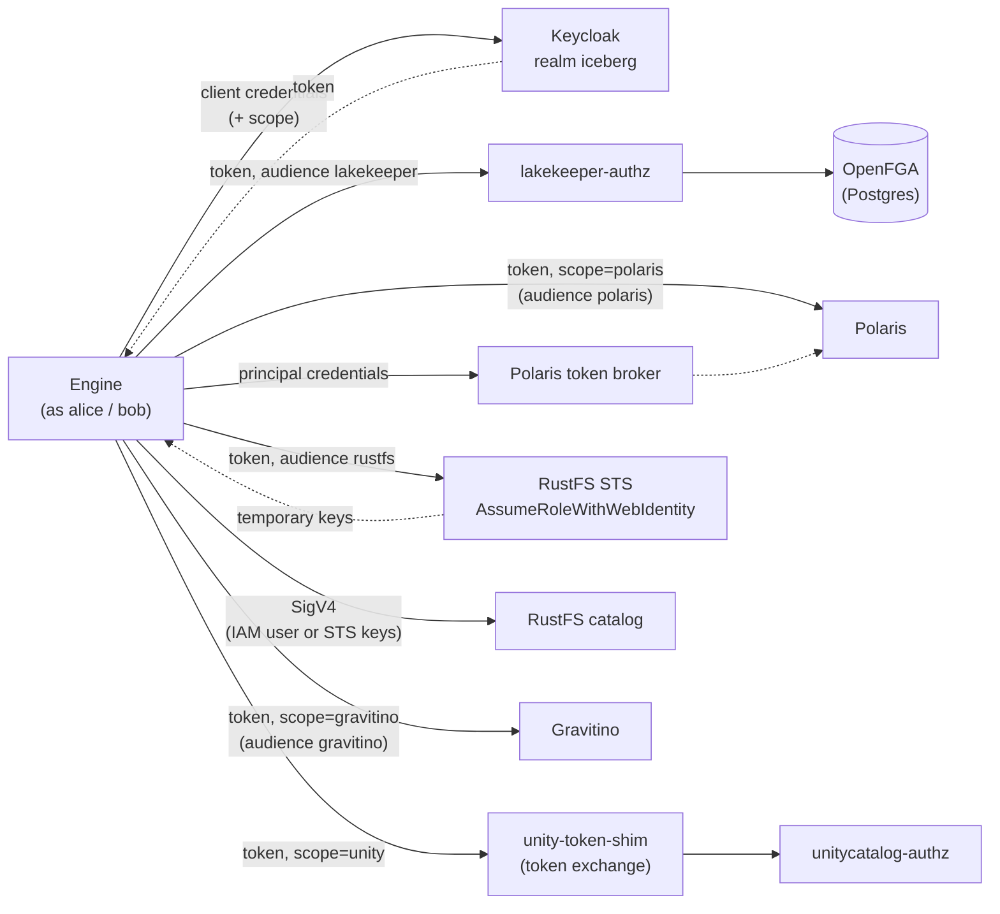
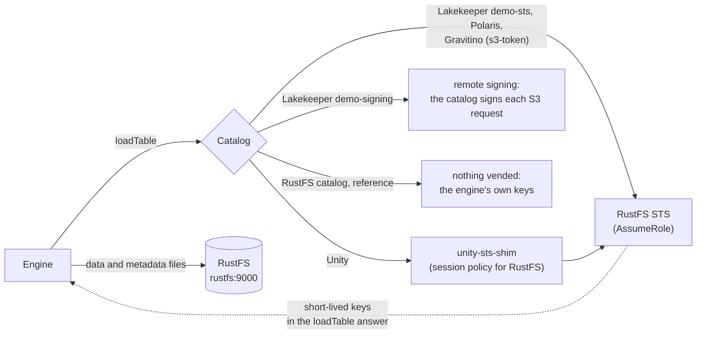
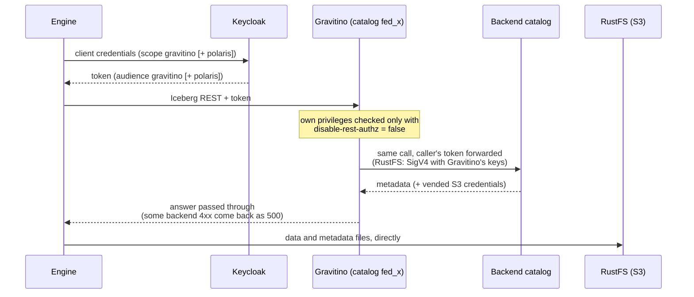

# Lab setup in detail

Back to the [README](../README.md).

## pg_lake

pg_lake (Snowflake-Labs) publishes no runnable images – GHCR only has CI build environments, and
its `docker/` setup is a development environment that compiles Postgres 16–19 with assertions.
`pg_lake/Dockerfile` therefore builds pg_lake **v3.7.1** from source on the official image
`postgres:19.0-trixie`: vcpkg (Azure SDK, which pg_lake links statically), then `make install`
(DuckDB 1.5.6 with pg_lake's patches, the extensions, `pgduck_server`); a second stage copies only
the installed files and checks with `ldd` that no shared library is missing. The first build takes
about 1.5–2 hours (DuckDB) with 2 parallel jobs – DuckDB's link step needs ~3 GB RAM per job, so
build it alone. A ccache cache mount makes a rebuild after a later failure quick.

The build needs ~35 GB free disk at its peak (the DuckDB build tree, removed in the same layer);
the image is ~1.1 GB (`libduckdb.so` stripped of debug info). The DuckDB version is set from
pg_lake's `DUCKDB_VERSION` (the shallow clone has no git tags - without it DuckDB calls itself
v0.0.1 and pgduck_server cannot load its extensions). Without BuildKit (`docker buildx` missing)
the cache mount is refused: build a copy of the Dockerfile without
`--mount=type=cache,target=/root/.ccache` with `docker build --build-arg JOBS=4 -t
iceberg-lab/pg-lake:3.7.1-pg19 -f <copy> pg_lake`, then `docker compose ... up -d --no-build`.
`scripts/build_polaris_console.sh` handles the missing BuildKit itself.

One container, two processes (`pg_lake/entrypoint.sh`): `pgduck_server` (embedded DuckDB, reads and
writes the files in S3) in the background, Postgres in the foreground; they connect through the
socket `/var/run/pgduck/.s.PGSQL.5332`. Two pitfalls are solved there:

- `AWS_EC2_METADATA_DISABLED=true` – otherwise DuckDB's AWS credential chain hangs at startup on the
  EC2 metadata endpoint, `pgduck_server` never opens its socket and Postgres reports
  `could not start query engine`.
- `--memory_limit 2GB` (`PGDUCK_MEMORY_LIMIT`) – DuckDB's default is 80 % of the host RAM.

Lakekeeper and Unity run without authentication here: pg_lake connects with its own option
`rest_auth_type 'none'` (no token). Polaris: its real OAuth2 token endpoint.

## Flink

`flink/Dockerfile` extends `flink:2.3.0-java17` with `iceberg-flink-runtime-2.3` and
`iceberg-aws-bundle` (1.12.0) plus the Hadoop client. One container starts JobManager and
TaskManager (`start-cluster.sh`) and the **SQL Gateway** (`:8083`) in the foreground. PyFlink does
not fit the lab environment (it pins old pyarrow/pandas), so the `FlinkEngine` adapter speaks Flink
SQL through the gateway's REST API: one batch-mode session per adapter, both warehouses as Iceberg
REST catalogs `sts` and `signing` (remote signing works, as with Spark, through the Iceberg Java
code). The gateway's JSON format cannot output `VARIANT` or maps with non-string keys; the metadata
tests cast such columns to `STRING`.

## Authentication and authorization – on the catalogs with authentication

`tests/security/test_authz.py` checks the same scenarios on every catalog (alice: read on
`t_select`, read and write on `t_modify`, nothing on `t_none`; bob: no rights; every engine logs in
as alice and as bob). How users, rights and login are set up per catalog is in
`tests/lab/authz_backends.py`:

| Catalog | Authz instance | Login | Rights |
|---|---|---|---|
| Lakekeeper | second instance `lakekeeper-authz` (profile `authz`) | Keycloak, OAuth client credentials | OpenFGA, per table |
| Polaris | main instance (RBAC always on) | its own token broker: principals `az_alice`/`az_bob` with fixed credentials; plus Keycloak as external identity provider (`mixed`, principal `alice`, token with `scope=polaris`, audience `polaris` required) | catalog role with table privileges |
| RustFS | main instance | IAM users `az-alice`/`az-bob`, SigV4; plus Keycloak via STS `AssumeRoleWithWebIdentity` (clients `rustfs-alice`/`rustfs-bob`, policy from the claim `rustfs_policy`, audience `rustfs` only) | catalog actions per bucket (`admin:GetTable`, `admin:CommitTable`, ...); read/write per table through S3 policies on data and metadata |
| Unity | second instance `unitycatalog-authz` (profile `unity`) | Keycloak → `unity-token-shim` (client credentials with `scope=unity` → Unity token exchange; Unity requires audience `unity`) | `USE CATALOG`/`USE SCHEMA` + `SELECT`/`MODIFY` per table |
| Gravitino | main instance (authorization on) | Keycloak, OAuth client credentials with `scope=gravitino` (audience `gravitino`); users `service-account-alice`/`-bob` in metalake `lab`; groups from the claim `lab_roles` | roles with `USE_CATALOG`/`USE_SCHEMA` + `SELECT_TABLE`/`MODIFY_TABLE` per table, granted to users or groups |

How an engine logs in as alice or bob, per catalog:



Every token names only the audience of the service it is issued for (`src/iceberg_lab/keycloak.py`,
set up with `scripts/keycloak_audiences.py`): Lakekeeper by default, Unity and Polaris through
optional scopes, RustFS through its own clients – RustFS rejects tokens with further audiences.

Beyond single grants, `tests/security/test_rbac.py` checks roles (members, removal, several roles,
a grant on a namespace, a role from the Keycloak token) and `tests/security/test_privileges.py`
checks which privileges each catalog knows (`docs/api/privileges-<catalog>.txt`) and what the
common ones do. In short:

| | Roles | Role from the token | Grant on a namespace | Single privileges (see, list, create, alter, drop, grant on) |
|---|---|---|---|---|
| Lakekeeper | ✓ | ✗ (only with Cedar; the lab uses OpenFGA) | ✓ | all |
| Polaris | ✓ (principal + catalog role) | ✗ (only together with an assignment in Polaris) | ✓ | all |
| RustFS | ✓ (IAM groups) | ✓ (policy claim) | – (data does not live under the namespace) | all except granting on (IAM administration only) |
| Unity | – (no groups) | – | ✓ | create only (everything else is reserved to the owner) |
| Gravitino | ✓ (roles for users and groups) | ✓ (groups from the claim `lab_roles`) | ✓ | create, alter, list (shows only the tables the user may read or modify), grant on; no privilege for describe or drop (owner only) |

Trino uses fixed catalog files per catalog and user (`lk_authz_*`, `pol_authz_*`, `rfs_authz_*`,
`uc_authz_*`). What a catalog does not offer (remote signing except on Lakekeeper, vended
credentials on RustFS) is shown as "not offered".

### Lakekeeper in detail (profile `authz`)

A **second** Lakekeeper (`lakekeeper-authz`, its own database `db-authz`) with OIDC through
**Keycloak** (realm `iceberg`, `authz/keycloak/realm.json`) and authorization through **OpenFGA**
(tuples in Postgres, database `openfga` in `db-authz`, so they survive a restart). The main Lakekeeper
stays open; the other tests are not affected. Identities are client-credentials service accounts:
`lab-admin` (bootstrap, warehouses `authz-sts` and `authz-signing`, grants rights), `alice` (receives
rights), `bob` (none). Trino uses the catalogs `lk_authz_alice`/`lk_authz_bob`; pg_lake needs
`scope 'openid'` in its server options (its default `PRINCIPAL_ROLE:ALL` is a Polaris convention that
Keycloak rejects).

### Unity in detail

`unitycatalog-authz` runs with `server.authorization=enable` (`unity/server-authz.properties`) and
accepts Keycloak as issuer. Unity maps a token to the user whose external ID equals the client ID in
the token. The bootstrap creates `alice` and `bob` through SCIM. `unity/token_shim.py` does the token
exchange, so all engines use plain OAuth client credentials; `lab-admin` gets Unity's own admin token
(from the instance's configuration volume).

## Other catalogs: `CATALOG=polaris|rustfs|unity|reference|gravitino|gravitino_<backend>`

The whole suite can run against another Iceberg REST catalog: `CATALOG=polaris
scripts/run_all.sh` (default: Lakekeeper). All engines take URI, warehouse and login from the
catalog profile in `src/iceberg_lab/config.py`; results go to `reports/polaris/`. The base tests are
identical on all catalogs and for all engines; tests of special features run separately and do not
count in the comparison (`docs/test-architecture.md`).
Before the run, `scripts/cleanup_storage.py` removes the catalog's test leftovers (leftover
`test_*` namespaces, files without a table, older than 3 h): RustFS, Unity and Lakekeeper do not
delete on drop (or only later), and tens of thousands of orphaned objects slow RustFS down until
large read/write tests time out. Without `--apply` it is a dry run; `CLEANUP=0` skips the cleanup.
Where the engines get their S3 access for the data files:



**Apache Polaris 1.9.0** (profile `polaris`, `docker compose --profile polaris up -d polaris`)
runs on the same RustFS with in-memory persistence; the bootstrap creates the catalog
`polaris_sts` (STS through RustFS, `drop-with-purge` enabled – the Polaris default is off) and gives
the root principal `CATALOG_MANAGE_CONTENT`. What a catalog does not offer (Polaris: remote
signing) shows as "not offered" in the report. The demo notebooks also run against every catalog.
Polaris runs with catalog federation enabled (`ENABLE_CATALOG_FEDERATION`, connection type
`ICEBERG_REST`) so that `test_federation*` can create an external catalog on Lakekeeper.
**RustFS catalog** (`CATALOG=rustfs`, no separate service): the Iceberg REST catalog built into
RustFS ("Table Buckets", `/iceberg`). The bootstrap creates the bucket `labtables` and enables it
(`PUT /iceberg/v1/buckets/labtables`). Login with SigV4; RustFS vends no credentials
(`client-provided-s3-credentials-required`), the engines use their own. The lab's own PyIceberg
(setup, cross-reads) sends the `x-amz-content-sha256` header RustFS requires itself; when PyIceberg,
Polars or Daft is the engine under test, this fix is off (`conftest._pyiceberg_engine_role`).
pg_lake has no SigV4 and shows as "not offered".

**Unity Catalog OSS 0.7.0** (`CATALOG=unity`, profile `unity`: `docker compose --profile unity up -d unitycatalog`):
Iceberg REST under `/api/2.1/unity-catalog/iceberg`, warehouse = Unity catalog `lab`, storage in the
bucket `unitylab`. Unity knows no custom S3/STS endpoint; an Envoy gateway (`unity/envoy.yaml`) takes
over the AWS host names inside the compose network with a local CA, and an STS shim
(`unity/sts_shim.py`) translates Unity's session policies for RustFS (both modelled on Unity's docs
environment). The engines get short-lived credentials from Unity and talk to `rustfs:9000` directly.
pg_lake commits every write through `/transactions/commit`, which Unity does not offer – pg_lake
still reports success; the adapter therefore refuses writes on such catalogs with a clear message,
and `test_pglake.py::test_insert_commits_to_catalog` shows the real behaviour.

**Apache Iceberg REST fixture** (`CATALOG=reference`, profile `reference`:
`docker compose --profile reference up -d reference`): the reference implementation of the REST
spec (`apache/iceberg-rest-fixture`, Iceberg `main`, pinned by digest), JDBC/SQLite backend inside
the container, storage in the bucket `reference` (created by the bootstrap). No authentication, no
credential vending and no REST prefix: the engines use their own keys. Its state lives in the
container - `docker compose --profile reference up -d --force-recreate reference` empties it
(names it accepted but cannot serve again cannot be dropped through the API,
`reference-names-unaddressable`). pg_lake cannot use it (`pglake-requires-rest-prefix`).

**Apache Gravitino 1.3.1** (`CATALOG=gravitino`, profile `gravitino`:
`docker compose --profile gravitino up -d gravitino`, which also starts Keycloak and creates the
database `gravitino` in `db`): Gravitino's Iceberg REST service as auxiliary service of the
Gravitino server (`gravitino/gravitino.conf`). The warehouse names a `lakehouse-iceberg` catalog of
metalake `lab`; the bootstrap creates `gravitino_sts` (Iceberg JDBC backend on Postgres, S3FileIO on
RustFS, vended STS credentials via `s3-token`). Engines authenticate with Keycloak tokens (client
credentials of `lab-admin`, `scope=gravitino` for the audience); authorization is on and
`lab-admin`'s service account is the service admin and owner of the metalake.

**Gravitino in front of another catalog** (`CATALOG=gravitino_lakekeeper`, `gravitino_polaris`,
`gravitino_unity`, `gravitino_rustfs`; the backend's profile must run too): the bootstrap creates a
Gravitino catalog `fed_<backend>` with `catalog-backend = rest` on the backend's Iceberg REST
endpoint and warehouse, and checks that its namespaces can be listed. Gravitino forwards the
caller's token to the backend - so the clients' token also names the backend's audience where it
checks one (Polaris: `scope=gravitino polaris`, and the Polaris principal `lab-admin` with principal
role `service_admin`). RustFS is the exception: Gravitino signs with SigV4 and the lab's keys
(`gravitino.bypass.*`), RustFS vends nothing, and the clients use the lab's S3 keys. Storage
credentials the backend vends reach the clients unchanged.

By default Gravitino does not check its own privileges for such a catalog
(`gravitino.iceberg-rest.disable-rest-authz`, default `true`): a user without any grant reads and
creates tables, only the backend's own check of the forwarded token is left. The lab sets it to
`false` (`gravitino/gravitino.conf`), so Gravitino decides before it forwards. A backend that
checks the token by its own grants (Polaris) then decides a second time, and every right has to
be granted in both (`gravitino-rest-backend-grants-not-forwarded`). A fixed service identity
towards the backend is no way out, see [findings](findings.md#gravitino-in-front-of-another-catalog).



For views, all engines give the catalog the same name per catalog profile: `sts` (Lakekeeper),
`psts` (Polaris), `rsts` (RustFS), `usts` (Unity), `refsts` (reference), `gsts` (Gravitino),
`glk`/`gpol`/`guc`/`grfs` (Gravitino in front of Lakekeeper/Polaris/Unity/RustFS) – Trino catalogs
are fixed files (`trino/catalog/`), and `sts` points at Lakekeeper.

## Version updates

Every engine, catalog and image version is pinned (uv.lock, docker-compose.yml, the Dockerfiles,
`ICEBERG_VERSION` in `src/iceberg_lab/engines.py`). `renovate.json` makes Renovate open one PR
per engine/catalog when a new version is out (Mondays; lab tooling monthly). It needs the
Renovate GitHub app on the repository - nothing runs until it is installed. Spark majors/minors
stay manual (Iceberg ships Spark runtimes only for some minors). What a version PR has to go
through is in [test-architecture.md](test-architecture.md#new-versions-and-new-features-show-up).

## Services

| Service | Address (in the container / host) | Purpose |
|---|---|---|
| RustFS | `rustfs:9000` / `localhost:9000`, console `:9001` (`rustfsadmin`/`rustfsadmin`) | S3, bucket `warehouse` |
| Lakekeeper | `lakekeeper:8181` – `/catalog`, `/management`, `/ui` | Iceberg REST catalog |
| Postgres | `db:5432` | Lakekeeper metadata |
| Trino *(profile `trino`)* | `trino:8080` | catalogs per catalog: `lk_*` (Lakekeeper), `pol_*` (Polaris), `rfs_*` (RustFS), `uc_*` (Unity), `ref_*` (reference), `grv_*` (Gravitino), `grvlk_*`/`grvpol_*`/`grvuc_*`/`grvrfs_*` (Gravitino in front of Lakekeeper/Polaris/Unity/RustFS); plus `*_proxy` (fault proxy), `*_authz_alice/bob` (authorization) and the view catalogs |
| pg_lake *(profile `pglake`)* | `pg-lake:5432` / `localhost:5433` | Postgres 19 + pg_lake 3.7 + `pgduck_server` |
| Flink *(profile `flink`)* | web UI `flink:8081`, SQL Gateway `flink:8083` | Flink 2.3.0 + Iceberg 1.12.0 |
| Polaris *(profile `polaris`)* | `polaris:8181` / `localhost:8183` – `/api/catalog`, `/api/management` | Apache Polaris 1.9.0 |
| Lakekeeper-authz *(profile `authz`)* | `lakekeeper-authz:8181` / `localhost:8282`, Keycloak `keycloak:8080` / `localhost:30080` | OIDC + OpenFGA |
| Unity Catalog *(profile `unity`)* | `unitycatalog:8080` / `localhost:8380` – `/api/2.1/unity-catalog`, Iceberg REST under `…/iceberg` | Unity Catalog OSS 0.7.0, plus `unity-gateway` (Envoy), `unity-sts-shim` |
| Unity-authz *(profile `unity`)* | `unitycatalog-authz:8080` (compose network only), `unity-token-shim` | authz instance for `test_authz.py` |
| Polaris Console *(profile `polaris`)* | `polaris-console:8080` / `localhost:8184` | Polaris web UI (image from `apache/polaris-tools`, `scripts/build_polaris_console.sh`) |
| Unity UI *(profile `unity`)* | `unity-ui:3000` / `localhost:3000` | Unity web UI (`unitycatalog/unitycatalog-ui`), points at the authz instance |
| Unity UI, main instance *(profile `unity`)* | `localhost:3001` | the same UI on the main instance: no login, the lab's data (own network `unity-ui-main`, where the UI's fixed proxy target `server` is the main instance) |
| Gravitino *(profile `gravitino`)* | `gravitino:8090` / `localhost:8090` – API `/api` and web UI; Iceberg REST `gravitino:9001` / `localhost:8186` under `/iceberg` | Apache Gravitino 1.3.1, tokens from Keycloak; plus `keycloak-browser` (`127.0.0.2:8080`, for the web UI login) |

**Gravitino web UI login** (`http://localhost:8090`, user `lab-ui`, password `lab-ui`):
Gravitino accepts tokens of exactly one issuer, `http://keycloak:8080/realms/iceberg`, and its UI
sends the browser there to log in. The host must therefore resolve `keycloak` itself. Add this
line to the host's `/etc/hosts` once:

```
127.0.0.2 keycloak
```

`keycloak-browser` forwards `127.0.0.2:8080` to Keycloak unchanged, so the issuer stays the one
Gravitino expects. Trino keeps `localhost:8080`, now bound to `127.0.0.1` only. The UI client is
`gravitino-ui` (public, PKCE). `lab-ui` has role `lab_ui` in metalake `lab`: browse and change
catalogs, schemas, tables and views, but no users, roles or grants (`iceberg_lab.bootstrap`).

Versions are pinned (checked 2026-11-25): Lakekeeper `v0.15.1`, Polaris `1.9.0`, Unity Catalog
`v0.7.0`, RustFS `1.0.6`, Gravitino `1.3.1`, Trino `484`, Spark `4.1.4` with `iceberg-spark-runtime-4.1_2.13:1.12.0`,
Flink `2.3.0` with `iceberg-flink-runtime-2.3:1.12.0` and Hadoop client `3.5.0`, PyIceberg `0.12.0`,
DuckDB `2.0.1` (its `iceberg`/`httpfs` extensions are installed at run time and follow the DuckDB
version; the manifest records the installed extension versions), Polars `2.2.0`, Daft `0.7.26`,
Keycloak `26.8.2`, OpenFGA `v1.23.0`, Envoy `v1.40.2`,
Postgres `17.12` (catalog databases) and `19.0` with pg_lake `3.7.1` (built from source; the
extension itself reports version `3.6`, which is the number the findings use). What a run actually
ran with is recorded in its manifest (`reports/.../manifest.json`, `results/<catalog>.manifest.json`).
Deliberately not the latest:

| Component | Lab | Latest | Reason |
|---|---|---|---|
| PySpark | 4.1.4 | 4.3.0 | Iceberg 1.12 has no runtime for Spark 4.2+ |
| PyArrow | 25.0.1 | 26.0.1 | Daft 0.7.26 requires < 26 |
| boto3 | 1.43 | 1.44 | s3fs/aiobotocore pin the botocore version |

Whether an engine can do something after an update that its tests skip as "not offered" is
checked by `tests/selftest/test_na_claims.py` (version pin + probes); new endpoints of a catalog are
reported by `tests/selftest/test_feature_inventory.py::test_advertised_endpoints_are_recorded`.

## Access modes: how engines get to the files

Different per catalog: **Lakekeeper** offers both modes as two warehouses (table below),
**Polaris** and **Unity** only vended credentials (Polaris: warehouse `polaris_sts`, Unity: catalog
`lab`, credentials valid for 1 h each), the **RustFS catalog** vends no credentials – the engines
log in with their own S3 keys (SigV4). What a catalog does not offer shows as "not offered" in the
report.

| Warehouse (Lakekeeper) | Engine's S3 access | Security |
|---|---|---|
| `demo-signing` | **Remote signing** – Lakekeeper signs every S3 request | the engine never sees keys; Lakekeeper checks every access |
| `demo-sts` | **Vended credentials** – short-lived STS keys (RustFS `AssumeRole`), restricted to the table path | keys stay valid until they expire, cannot be revoked |

Engines that cannot do remote signing get static RustFS keys on `demo-signing` (DuckDB
`CREATE SECRET`, Trino `lk_signing`, Polars `storage_options`, Daft).

