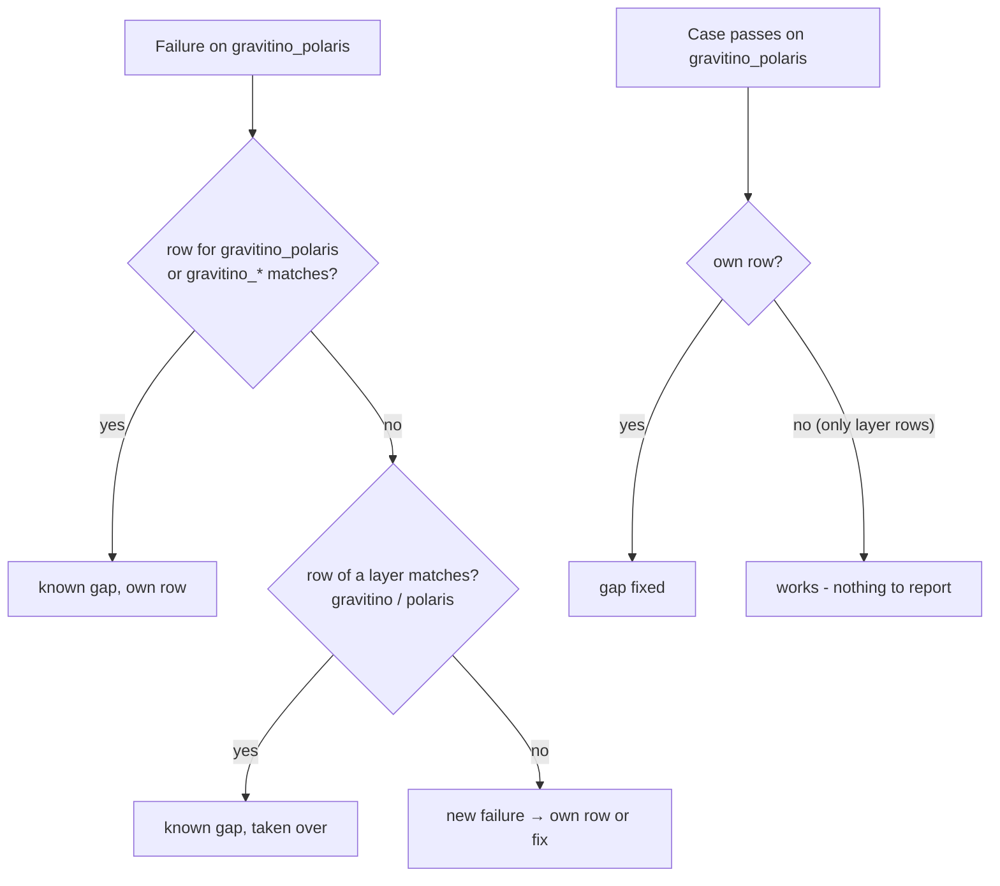
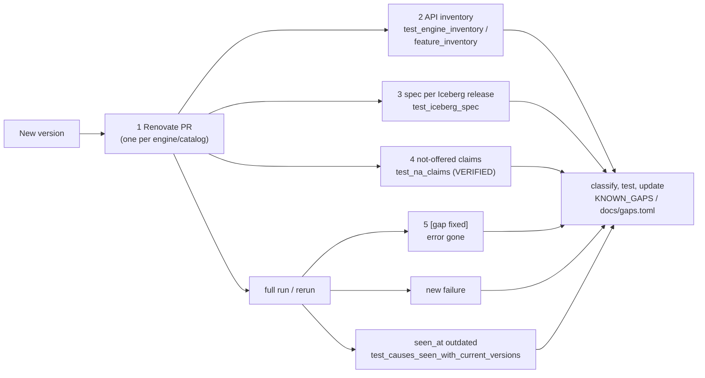

# Test architecture: base and special features

Goal: an overview of what works with which engine and which catalog and what does not, and which
special features exist. Every claim in it is backed by a test: every cell has its test ID (pytest
node ID) with status and cause, verifiable by running exactly this test again. Without a test there
is no claim.

There are two layers for this.

## 1. Base tests (feed the comparison)

The base tests are identical on both levels, and **all six catalogs and all eight engines take
part**: every base case runs for every combination. Exceptions exist only as a result, never as a
missing row.

- **Every engine** runs the same test cases. If an engine cannot do something, it shows "not
  offered" with a verified reason. The test case is not left out.
- **Every catalog** runs the same test cases (same test names, same parameters). What a catalog
  does not offer is also "not offered" with a verified reason.
- Parameter names are neutral (`sts`, `signing`), not catalog-specific warehouse names, so that the
  same cases stand side by side in the comparison.
- Only the base tests count in coverage, reliability and the catalog comparison.

### Gravitino in front of another catalog: the gaps of both layers

The profiles `gravitino_<backend>` (`FRONTED` in `src/iceberg_lab/config.py`) run the whole
suite through Gravitino against a Gravitino catalog with `catalog-backend = rest` that forwards
to Lakekeeper, Polaris, Unity or RustFS. Each is a catalog of its own in the comparison; code that
depends on the server (adapters, users, privileges) asks `PROFILE.server` ("gravitino"), gap rows
and skip texts name `PROFILE.name`.

A case through Gravitino can fail for a reason of either layer. Gap rows of `gravitino` and of the
backend therefore apply to the fronted profile too (`gap_register.find_gap`, and the central
`gaps.CATALOG_GAPS`), but only as *possible* gaps: booked when the error matches the row, silent
when the case passes - a backend gap that Gravitino happens to avoid is no "gap fixed". Anything
else is a new failure and gets a row of its own, `gravitino_*` for a cause of the federation
itself.

Gap tables without a catalog column take a catalog's block with `layer_rows("unity", [...])`
instead of `[...] if PROFILE.name == "unity" else []`: the same rows, as the catalog's own on
Unity, as possible gaps on `gravitino_unity`, none elsewhere. `PROFILE.layers` names the three
(`("gravitino_unity", "gravitino", "unity")`); the notebooks use it the same way - a cell's own
`expect_gravitino_unity` wins, else `expect_gravitino` (or the general check) and
`expect_unity` are alternatives. Often the backend's message survives and only the status
changes (Gravitino answers many of the backend's 4xx with 500); such cases need an own row with
the Gravitino form of the message.

`tests/catalog/test_gravitino_fronting.py` adds what the suite cannot see from one side:
it also uses the backend directly (`tests/lab/fronting.py`).

### "Not offered" is checked, not claimed

A skip "<engine> has no API for <capability>" is only allowed when something proves it, so that
a new engine version that gains the capability cannot hide behind an old skip.

Tests do not keep engine lists for this. They call
`require(engine, capability, engine_pool)` (`src/iceberg_lab/lab/capabilities.py`): the registry
`OFFERED` names the engines that offer a capability, and for every other engine the claim is
checked (below) or proven by a test of its own (`PROVEN_BY`, with the proving test). One place to
read and to change after an engine update. `tests/selftest/test_capability_registry.py` keeps it
that way: every missing capability has an API pattern or a proving test, every proving test
exists, and no test outside the self-tests skips an engine by name (`if writer == "pg_lake":
pytest.skip(...)`) - the one allowed exception, Flink's refused `MERGE INTO`, is a real try.

- **API check** (`capabilities.not_offered`, called by `require`): the engine's live API -
  functions, procedures, methods and, for Polars/Daft, the parameters of their Iceberg functions
  (the source of `test_engine_inventory.py`) - must hold no name matching the capability's
  pattern (`CAPABILITY_API`). A match fails the test as a new failure; a match that does not
  provide the capability is listed with its reason in `NOT_OFFERED_EXEMPT`.
- **A try** where it is cheap: Flink `MERGE INTO`, Lakekeeper's generic-tables create call,
  Polars `sink_iceberg` as streaming write. Refused with the expected error: not offered;
  accepted: the claim is outdated.
- **A test that proves it**: pg_lake writes no foreign tables
  (`test_pglake.py::test_attached_table_is_read_only`), pg_lake creates only v2 and has no SigV4,
  the SQL types (`test_na_claims.py` probes), pg_lake's MERGE (fails with its gap in
  `test_operations.py`).
- The API check covers APIs, not SQL grammar. A new SQL statement (e.g. UPDATE in Flink) is
  caught by the version pin of `test_na_claims.py`, which fails on every engine version change.

On its first run (2026-11-22) the API check found four outdated claims: Polars reads
incrementally (`scan_iceberg(from_snapshot_id_exclusive=, to_snapshot_id_inclusive=)`, now
tested), PyIceberg creates views (`Catalog.create_view`), DuckDB sets namespace properties
(`set_iceberg_schema_properties`), Polars adds columns while writing
(`sink_iceberg(schema_mode='merge')`). All four are tested now: PyIceberg creates its view with
one SQL representation per dialect (it has none of its own), so DuckDB and Spark run it.

### Engine-specific steps live in the adapters

Where several matrices need the same engine-specific step, the adapter
(`src/iceberg_lab/engines.py`) has a method for it instead of an `if engine == ...` in each test:
`append_arrow` (the DataFrame engines' own Arrow write path), `set_session_zone` (with
`session_zone_sql` per SQL engine; checks the zone took effect), `PgLakeEngine.create_owned_table`
(pg_lake writes only tables it created). Tests branch on the interface (`adapter.dialect is None`)
or the registry (`offers(...)`), not on names. The dialect-specific SQL of the operation classes
stays in the tests: it is what they test.

### New versions and new features show up

Five mechanisms make a new engine or catalog version visible instead of letting it pass unseen:

1. **Updates arrive as PRs.** `renovate.json` (Renovate GitHub app) opens one PR per engine/
   catalog for the Python packages (uv.lock), the images in docker-compose.yml and the Dockerfiles,
   and through regex managers for what no package manager sees: the Iceberg Java runtime of Spark
   and Flink (`ICEBERG_VERSION`), Hadoop, the pg_lake git ref, vcpkg. Each PR carries the lab
   checklist below.
2. **Every API name is used or classified.** `test_engine_inventory.py` fails when an engine's
   live API differs from `docs/api/engine-<engine>.txt`. Re-recording it is not enough: an
   offline self-test requires each name to occur in a test or the adapters, or to be listed in
   `docs/api/engine-classified.toml` as `ignored: <reason>` (helper, internal, conversion) or
   `untested: <what>` (the open list). An entry gets stale - and fails - once a test uses it.
   The catalogs' endpoints have the same rule through `tests/lab/feature_inventory.py`.
3. **The specification is recorded per Iceberg release.** `scripts/iceberg_spec.py` writes the
   REST endpoints and data types of the release in `ICEBERG_VERSION`
   (`docs/api/iceberg-rest-spec.txt`, `docs/api/iceberg-types.txt`).
   `tests/selftest/test_iceberg_spec.py` requires a conformance test per endpoint, a type case per
   type, and the recorded release to be the lab's - a Renovate PR for the Iceberg runtime fails
   until the spec is re-recorded and what it adds is tested. Its first run found five endpoints
   of the 1.12 spec without a test (functions ×2, register-view, unregister, sign).
4. **"Not offered" is checked** (above) and the versions it was checked at are pinned
   (`VERIFIED` in `test_na_claims.py`).
5. **Known gaps report `[gap fixed]`** when the error is gone.

Checklist for a version PR: `RECORD_INVENTORY=1 pytest tests/selftest/test_engine_inventory.py`,
classify new names, re-check the claims and update `VERIFIED`, `scripts/iceberg_spec.py` for an
Iceberg release, run the engine's tests, update the `KNOWN_GAPS` tables and `docs/gaps.toml`
(`scripts/gap_register.py confirm`, then `findings`), CHANGELOG.

### A "not testable" case belongs to the step that failed

A read whose table the writer could not produce says nothing about the reader. The report charges
it to the cause (`reporting.blocked_by`): the engine named in the skip reason ("not written by
X", "X v3 did not succeed in ..."), or the catalog when it makes the state impossible. It is in no
denominator of the reading engine and shows as "blocks N cases of other engines" at the cause.
Before this rule (2026-11-22) a reader lost up to 20 points of coverage for other engines' write
gaps.

## 2. Special features (not in the comparison)

Separate tests for what only one catalog or only one engine has. They show failures the same way
(known gaps only with the exact message), but do not count in the comparison:

- Area **"Catalog-specific"**, for example Lakekeeper soft delete/undrop, tags, statistics,
  namespace move and format policy; Polaris policies and federation; RustFS table buckets; Unity
  volumes and models. (Polaris and Unity both offer generic tables – that is base.)
- Area **"Engine-specific"**, for example pg_lake (extension, attached tables read-only, join with
  heap tables), the Polars lazy API and DuckDB's three-part schema name.

Rule (2026-11-15): classification is by **capability**, not by endpoint.

- **Base**: a capability that at least two catalogs (or engines) offer – whether through the
  Iceberg REST specification or through their own APIs. The test is the same for all; the
  implementation per catalog lives in an adapter (pattern: `tests/lab/authz_backends.py`). Catalogs
  without the capability show "not offered".
- **Special feature**: a capability that exactly one catalog or exactly one engine has.

Which catalog offers which capability through which endpoint is in the feature inventory
(`docs/feature-inventory.md`, generated from the catalogs' API descriptions).

## 3. Themes

The 50+ compared areas are grouped into eight themes (`src/iceberg_lab/lab/reporting.py`, `THEMES`; a lab self-test keeps every compared area in exactly one theme). The report gives reliability per theme and the mean over the themes, each theme counting equally - without that, the large matrices (the type matrix alone is about a third of all cases) decide every total. The dashboard starts from the themes.

## 4. Assignment in the report (`src/iceberg_lab/lab/reporting.py`)

Every test belongs explicitly to one area. Only "Engine-specific" (the engine files in
`ENGINE_FILES`), "Catalog-specific" (marker `@pytest.mark.specific`), "Demo notebooks" and "Lab
self-test" are not compared. A test without an area shows up as "Unassigned" and is counted. So it
does not silently drop out of the comparison, as happened before to the base tests for scan
planning, object storage and credential reach.

### Result overview (goal of the rework)

- **Engines × catalogs**: base areas per engine and catalog (works / gap / not offered / not
  testable) with cause.
- **Catalog level**: tests without an engine (REST functions, authorization, scan planning, object
  storage) as a separate table catalog × capability. They were missing from the engine tables
  because they belong to no engine.
- **Special features**: one list per catalog and per engine, separate from the comparison.
- Every cell links to its test IDs as evidence.

## 5. Open

- Missing infrastructure: partition pruning (an engine-neutral measurement of the files read, e.g.
  a logging S3 endpoint all eight engines use – pg_lake, Trino and DuckDB have their own, statically
  configured S3 access), query across two warehouses (every engine needs a second catalog).
- Keycloak outage on the catalog side (the catalog itself can no longer reach Keycloak): a proxy in
  front changes the address and thus the tokens' issuer; checked is the outage of the token endpoint
  from the clients' point of view.

The history of the rework (2026-11-15 to 2026-11-20) is in [CHANGELOG.md](../CHANGELOG.md).

## Feature inventory (as of the pinned versions)

All 540 endpoints of the six catalogs (Lakekeeper 178, Polaris 76, RustFS 37, Unity 62,
reference 31, Gravitino 156) are assigned in `tests/lab/feature_inventory.py` to exactly one of 59 capabilities; the overview is in
`docs/feature-inventory.md`. The lab tests Iceberg REST catalogs: 8 capabilities without a bearing
on Iceberg tables (ML models, volumes/filesets, functions, generic/Delta tables, topics, jobs, the
own schema/table APIs next to Iceberg REST, credentials for non-Iceberg objects) are recorded as
**Out of scope** - listed so every endpoint stays classified, not tested. Every other capability
has a test as evidence, every base capability a test that runs on all catalogs. The inventory distinguishes ✓ (described and implemented), ◐ (described,
not implemented by the server – example: Lakekeeper describes scan planning but answers 404;
Polaris describes remote signing but answers 501) and – (not offered).

### API size is no measure of functionality

The endpoint counts cannot be compared directly:

- **The sources differ** (header of the files in `docs/api/`): Lakekeeper from the running OpenAPI
  description, Polaris from the JARs' annotations, RustFS from strings in the binary (without HTTP
  methods, hence too low), Unity only its own API – its Iceberg REST endpoints are not listed there.
- **The cut differs**: Lakekeeper (178) and Polaris (76) are close on the Iceberg REST standard
  (35 to 29). The difference is in administration (143 to 47): for tables, namespaces, views and
  generic tables Lakekeeper has separate endpoints each for protection, tags, permissions and allowed
  actions (about 43 together), plus projects, tag definitions, background tasks, trash bin, search
  and statistics. Polaris handles permissions compactly through roles and grants (21 endpoints).

The number of capabilities is more meaningful (of 54, header of `docs/feature-inventory.md`):

| | Lakekeeper | Polaris | RustFS | Unity | Iceberg REST fixture |
|---|---|---|---|---|---|
| described in the API | 39 | 23 | 18 | 21 | 10 |
| of which implemented (without ◐) | 36 | 22 | 18 | 21 | 10 |

◐ means: described, but not implemented by the server at all – Lakekeeper scan planning, functions
and unregister (404 each), Polaris remote signing (501). Every ◐ is backed by a test's known gap
(`test_feature_inventory.py::test_not_implemented_is_proven`). Partial failures (e.g. RustFS: backup
501, directory and index work) stay ✓ with a note; how well a capability works in detail is shown by
the test results in the report. `tests/selftest/test_feature_inventory.py` keeps it that way: a new
endpoint after an update, a missing test or a stale overview stands out there.
