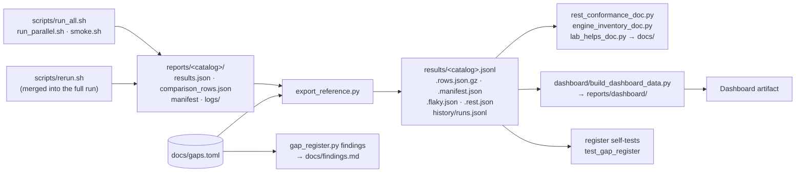
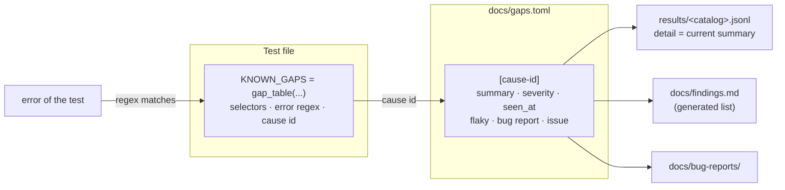
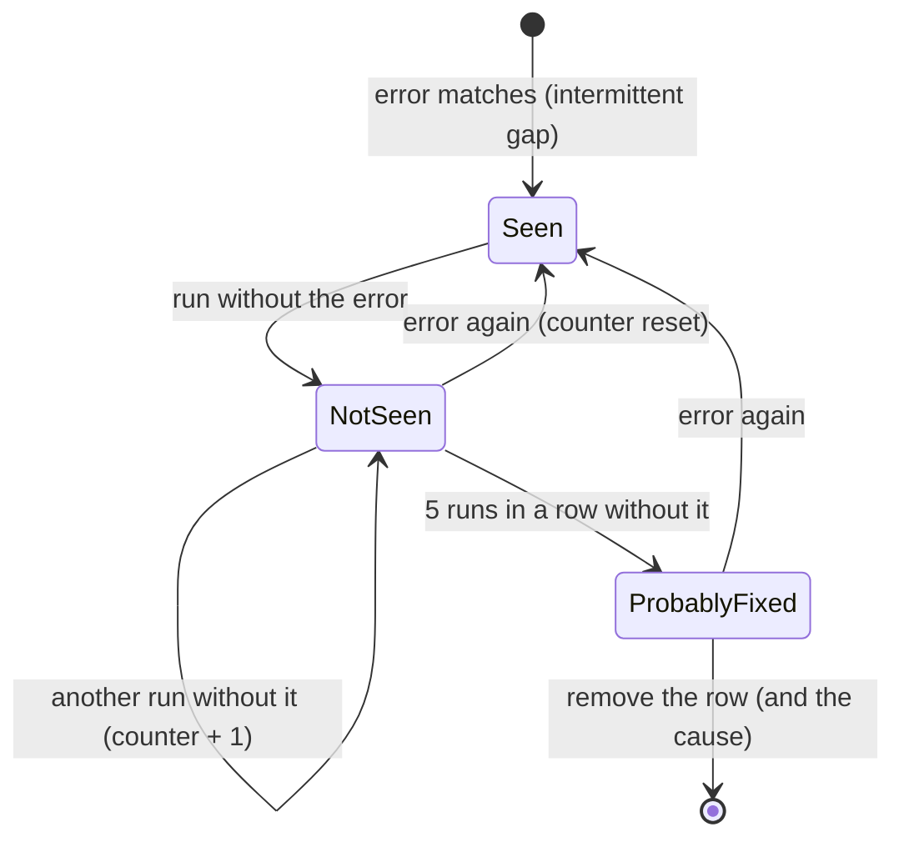

# Tests and the engine comparison

Back to the [README](../README.md).

## Engine comparison

Every test run writes `reports/results.json` (raw data, one entry per test) and
`reports/comparison_rows.json` (one row per test with theme, area, capability, severity and
run; Lakekeeper in `reports/`, other catalogs in `reports/<catalog>/`).
`scripts/export_reference.py` turns them into the references in `results/`, and the dashboard
shows them (overview "works / applicable" per engine and area, matrices, causes).
**Coverage** = works / all cases of the engine (not offered and its own "not testable" count as
not working), **reliability** = works / offered cases. Only the base tests are compared;
"engine-specific", "catalog-specific" and "lab self-test" are reported separately. Every test
belongs explicitly to one area (`src/iceberg_lab/lab/reporting.py`), and every area to one of
eight themes (`THEMES`); without an area it shows up as "unassigned" and is counted.

Three guards keep a lab error from distorting the figures unnoticed:

- a test the area rules (`DIMENSIONS`, `THEMES`) cannot place is a NEW failure of the run
  (`reporting.unclassified`), not an "Unassigned" row compared like a base test;
- the dashboard shows `works/offered` instead of a percentage when fewer than 5 % of the planned
  cases were offered ("1 of 1 works" is not 100 %);
- `scripts/reference_shifts.py` (end of `run_all.sh` and `rerun.sh`) prints a `SHIFT` line per
  engine whose reliability moved by more than 5 points, or whose offered cases changed by more
  than 10 %, against the committed reference - a warning to look at before the commit.

Further figures, because a plain total over all cases misleads:

- **Reliability per theme** and the mean over the themes, each theme counting equally - the
  type matrix alone is about a third of all cases and would otherwise decide every total.
- **Who a "not testable" case belongs to** (`blocked_by`): a read whose table the writer could
  not produce says nothing about the reader. It counts at the step that failed - the writing
  engine ("blocks N cases of other engines"), or the catalog when it makes the state
  impossible - and is in no denominator of the reading engine. A reader's ability to read such
  a table is shown by the neutral source (`tests/engines/test_neutral_source.py`: Iceberg Java
  writes each state once - types, operations, partitions, evolution, maintenance results, ORC/Avro
  files, the time zone values - and every engine reads it; every engine also appends after
  maintenance done by Iceberg Java).
- **Planned / ran**: every compared case, and those that actually ran (works, gap, new).
- **Run manifest**: every row names its run; `manifest.json` / `runs.json` record git commit,
  package versions, DuckDB extension versions and image digests (`src/iceberg_lab/lab/manifest.py`).

"Not offered" is never just claimed: tests ask `require(engine, capability, engine_pool)`
(`src/iceberg_lab/lab/capabilities.py`). The registry `OFFERED` lists who offers a capability;
for every other engine the claim is proven by a test of its own (`PROVEN_BY`) or checked against
the engine's live API (functions, procedures, methods, parameters) with a pattern per capability
(`CAPABILITY_API`). A matching name fails the test as a new failure - the engine may
have gained the capability - unless it is listed with a reason in `NOT_OFFERED_EXEMPT`. Where a
try is cheap, the test tries instead (Flink `MERGE`, Lakekeeper generic tables). The check
covers APIs, not SQL grammar; a new SQL statement is caught by the version pin in
`test_na_claims.py`.

## Layout

```
.devcontainer/          Dockerfile (Python 3.12, Java 17, uv), docker-compose.yml, devcontainer.json
src/iceberg_lab/        config.py, bootstrap.py, engines.py (adapter per engine), datatypes.py (type catalog v2+v3)
tests/                  see below; one folder per topic, each with its own README
notebooks/              00–09: one example notebook per engine + setup + interop matrix (09 = Flink), for every catalog (`CATALOG=…`)
trino/catalog/          Trino catalogs per catalog profile, warehouse and authz user
unity/                  Unity: Envoy gateway, STS shim, token shim, server(-authz).properties
docs/                   setup.md, tests.md (this file), findings.md, test-architecture.md (base vs. special
                        features, themes), feature-inventory.md (generated), api/ (endpoint lists of the
                        six catalogs), bug-reports/ (drafts, not filed)
results/                reference results of the latest full run per catalog + manifest (in git)
scripts/                run_all.sh (full run per catalog), run_parallel.sh (several catalogs at once),
                        smoke.sh (quick cross-section), rerun.sh (rerun tests on all catalogs,
                        merged into their full runs), export_reference.py (reports -> results/),
                        cleanup_storage.py (remove test leftovers), flaky_weekly.sh + systemd/
                        (weekly rerun of the intermittent gaps), dashboard/ (page + data builder)
authz/                  Keycloak realm (fixed service-account IDs) for the authz instances
flink/                  Dockerfile (Flink 2.3 + Iceberg JARs), start-lab.sh (cluster + SQL Gateway)
pg_lake/                Dockerfile (postgres:19.0 + pg_lake 3.7.1 built from source), entrypoint, init SQL
```

Test folders: `tests/lab` (shared modules, no tests), `tests/engines` (engine matrices),
`tests/catalog` (catalog level), `tests/security` (authentication, authorization, security),
`tests/storage` (storage and fault behaviour), `tests/specific` (engine-specific),
`tests/selftest` (lab self-tests), `tests/demos` (notebooks).

| Test file | Content |
|---|---|
| `test_access_delegation.py` | engine × warehouse × read/write with catalog credentials only; STS scope; signer scope |
| `test_interop.py` | every engine writes, every engine reads |
| `test_file_formats.py` | data formats ORC and Avro (besides Parquet): every engine writes into a table with `write.format.default`, the actual file format is checked; every engine reads |
| `test_types.py` | all Iceberg types (v2 + v3) × writer × reader: values (`test_read`) and type fidelity (`test_reader_type`: does the engine report the matching type, e.g. `uuid` instead of `string`?). pg_lake writes with its own Postgres types (composite for structs, `map_type` for maps). Plus `test_read_neutral`: every reader reads a table written by the lab client (PyIceberg) – this shows whether a reader can read a type at all, even where writers fail; special floats (NaN, ±Inf, -0.0) in the whole matrix, and `test_nan_metrics`: no NaN in the lower/upper bounds of any data file, NaN/NULL counts right where recorded (else filters prune wrongly) |
| `test_timezones.py` | session time zones: every SQL engine writes `timestamptz` (local time of the session) and `timestamp` (no zone) while its session zone is Kathmandu (+05:45), Berlin right after the DST switch or Los Angeles 1969; every engine reads: the instant must be the local time in UTC, the plain timestamp unchanged |
| `test_operations.py` | DDL/DML/evolution/time travel per engine, format v2 and v3; plus merge-on-read DELETE, a transaction with several changes (one commit), an aborted transaction, seeing foreign commits, identifier fields, CREATE on an existing table, filter/aggregation, listing tables; MERGE must be a single commit. Every engine writes its starting data itself (if it cannot, the test failed – no substitute engine); then **every other engine** reads the result back (`test_operation_cross_read`) |
| `test_v3_features.py` | deletion vectors, default values, row lineage |
| `test_maintenance.py` | maintenance per engine, v2 + v3: compact data files and delete files, rewrite manifests, expire snapshots, remove orphan files, DROP deletes files – each checked in the metadata, **directly in RustFS** and by cross-reads of all engines; afterwards every engine, the maintaining one included, appends a row to the maintained table (`test_maintenance_cross_write`) |
| `test_concurrency.py` | concurrent commits: 4 parallel appends per engine, all engines at once on one table, appends during a compaction, DELETE against UPDATE of the same row (isolation), two concurrent upserts of the same new key |
| `test_neutral_source.py` | neutral read source for operations, partitions, evolution and maintenance: Iceberg Java core (the reference implementation, directly through the JVM, without Spark SQL) writes every state once – natively v2 and v3, with position deletes, deletion vectors and equality deletes – then every engine reads. Neutral row fine, matrix cell red → the combination (mostly the writer's files); neutral row red → the reader |
| `test_rbac.py` | roles and inherited grants on all catalogs: a grant to a role reaches every member (and only that table), whoever leaves the role loses access at once, grants of several roles add up without spilling over, a grant on a namespace applies to its tables (also later ones) and not to others. Lakekeeper roles, Polaris principal/catalog roles, RustFS IAM groups; Unity OSS has no roles, RustFS no namespace data grants (both checked on every run) |
| `test_privileges.py` | single privileges: which privileges every catalog knows (`docs/api/privileges-<catalog>.txt`, read from the running images with `scripts/privilege_inventory.py`: Lakekeeper OpenAPI, Polaris/Unity enums, RustFS IAM actions; checked live, image version recorded) and what the common privileges do: see metadata without data, list tables, create, alter, drop, grant on – each positive (allows exactly its action, no more) and negative (refused without the privilege), with a single REST call |
| `test_ui.py` | web UI (each project's official UI): is it served, is it wired to the lab catalog, and does the data API behind it refuse anonymous requests (with a positive control)? Lakekeeper `/ui/` and the RustFS console from the server; Polaris Console (container `polaris-console`, image built from `apache/polaris-tools` with `scripts/build_polaris_console.sh`) and Unity UI (container `unity-ui`, port 3000) as separate containers |
| `test_stock_connection.py` | every engine connects without lab help (default configuration), writes and reads a table – evidence for the connection gaps the lab's helps work around (the only test that runs without them) |
| Lab helps and the run "without help" (`CATALOG=<catalog> LAB_NO_HELP=1 scripts/run_all.sh`) | engines that cannot connect without a sensible workaround get it in every run (`iceberg_lab.config.HELPS`: RustFS – PyIceberg, Polars, Daft, DuckDB); a test that works with it counts as working. The run without help repeats only these engines' tests without the workaround; own report `reports/<catalog>-nohelp/`, shown next to the comparison in the dashboard (grey columns "without help") and in `docs/lab-helps.md` (`scripts/lab_helps_doc.py`), not counted |
| `test_branch_isolation.py` | every engine reads `main` while a branch has a newer commit (must not show it), and writes to `main` without changing the branch |
| `test_recreate_session.py` | an engine has the table open, it is dropped and re-created with the same name: does the engine then read and write the new table? |
| `test_file_spec.py` | written files per specification: Avro metadata of every manifest (`partition-spec`, `format-version`, `content`, ...; `schema-id` separately), field IDs in every Parquet file – per engine |
| `test_sts_scope.py` | reach of a table's STS keys (directly with boto3): write/delete/list only in the own table, not in table B, the bucket root, another warehouse, foreign buckets; expiry time, renewal through `/credentials`, tampered token |
| `test_evolution.py` | partition transforms (identity, bucket, truncate, year/month/day/hour) × writer × reader with filters, schema evolution (rename/add/drop/widen) and partition evolution across engines; nested schema evolution (`test_nested_evolution_*`): a struct field added, renamed and dropped, map value and list element widened, required made optional, a column moved - then every engine appends in the new schema and every engine reads old and new files by nested field id |
| `test_views.py` | create views and read foreign views (dialects); PyIceberg creates view metadata with one representation per dialect; dependency on the catalog name |
| `test_namespaces.py` | namespaces per engine: create, nest, properties, do not drop non-empty ones, drop |
| `test_statistics.py` | compute table statistics (Puffin/NDV) and have Trino use them, partition statistics |
| `test_robustness.py` | fault proxy in front of the catalog (every catalog): lost commit response, 503 on commit, catalog gone, a concurrent commit forced right before the engine's own (409: the engine must reload and retry) – with an integrity check of the table |
| `test_storage_faults.py` | storage faults under the catalog (proxy in front of RustFS, own warehouse/catalog): metadata writes with 503, without response, slow; storage gone while loading; STS gone while vending – error instead of hanging, table intact, catalog recovers (Lakekeeper, Polaris; RustFS/Unity not testable) |
| `test_rustfs.py` | object storage: multipart upload, range reads, bulk delete, listing over 1000 objects, consistency (directly with boto3); plus per engine one large table (1.5 M rows, ~60 MB) written and read by all engines |
| `test_transactions.py` | transactions over two tables (DuckDB/pg_lake `BEGIN…COMMIT`, Flink `STATEMENT SET`, Trino): one atomic `/transactions/commit`? Does A stay unchanged when B's commit fails? |
| `test_wap.py` | write-audit-publish: write to a branch, check, publish to `main` |
| `test_incremental.py` | incremental reads, changelog, streaming writes and reads (Flink, Spark); Polars incremental reads through `scan_iceberg(from_snapshot_id_exclusive=, to_snapshot_id_inclusive=)` and its streaming sink `sink_iceberg` |
| `test_sts_expiry.py` | *(marker `long`)* do all engines keep reading with the same object/session after the vended credentials expired? Lakekeeper 900 s (~16 min wait), Polaris and Unity 1 h (~62 min; not configurable per catalog there), RustFS vends no credentials |
| `test_layout.py` | sort order (checked physically in every Parquet file) and target file size per writer |
| `test_performance.py` | run times: write 1 M rows, full scan, selective query – `reports/performance.md` |
| `test_authz.py` | on every catalog with authentication (Lakekeeper, Polaris, RustFS, Unity, Gravitino, and Gravitino in front of the others): anonymous refused, refused without a grant, a read grant reads but does not write (vended credentials read-only, signer refuses PUT), a table without a grant stays closed, write grant, revoking takes effect; every engine as alice/bob (`tests/lab/authz_backends.py`); refusal only with an authorization error (401/403, "not found" only on Lakekeeper, which hides objects) and only for an existing table; metadata of a table without a grant |
| `test_security.py` | security on all catalogs: forged/tampered/expired/foreign tokens and SigV4 signatures (Keycloak cases on every catalog with authentication: directly (Lakekeeper, Gravitino), through the token exchange, through Polaris' `mixed` mode and through RustFS STS; an expired token may also get the spec's 419), rights of a Keycloak identity on RustFS, token lifetime, escaping through the storage location (same/inner/outer location, moving the location, registering foreign metadata, registering metadata outside the allowed locations, `write.data.path`), secrets in responses, no storage keys in view responses, no secrets in Trino's query details, revealing error messages, dangerous names, privilege escalation (granting yourself rights, dropping/renaming/creating as a reader) |
| `test_rest_conformance.py` | REST conformance (raw REST, no client in between): every endpoint of the specification with a valid request (works / not offered / broken, matched against `/v1/config`), error documents, HEAD 204, missing parent, `snapshots=refs`, invalid `snapshots` value, missing metadata file – overview in `docs/rest-conformance.md` |
| `test_idp_outage.py` | outage of the token endpoint (proxy in front, no container is stopped), PyIceberg and Spark: a running session keeps working, a new session fails fast and recognisably, then recovery |
| `test_storage_s3.py` | the storage under all catalogs (RustFS S3 API against AWS behaviour): checksums, conditional writes, multipart error codes, STS session policies (prefix, deny, wildcards, duration) |
| `test_catalog_features.py` | catalog functions, the same list for every catalog (a missing one shows as "not offered"). **Base** (REST specification or ≥2 catalogs): register a table from a foreign catalog, rename across namespaces, drop a namespace after a rename, metrics report, `/credentials`, pagination, ETag/304, idempotency key, remote signing, sync with externally written metadata, tags (Lakekeeper, Gravitino), policies with inheritance (Polaris, Gravitino), storage validation (Lakekeeper, Gravitino), projects (Lakekeeper projects, Gravitino metalakes). **Special features** (marker `specific`, not in the comparison) – Lakekeeper: trash bin + undrop, protection, warehouse statistics, table search, move namespace, format-version policy, permission check, maintenance mode, endpoint statistics, task queue, "managed by", unregistering tables; Polaris: federation to Lakekeeper (direct and through a proxy without compression), OpenLineage; RustFS: enable/disable table buckets, unknown bucket, second endpoint `/_iceberg/v1`, table maintenance, refs API, metadata pointer, table management, backup; Unity: temporary path credentials; Gravitino: owners, custom statistics. Not tested: features without a bearing on Iceberg tables (ML models, volumes/filesets, functions, generic/Delta tables, topics, jobs; "Out of scope" in the feature inventory). Authorization on all catalogs: `test_authz.py` |
| `test_engine_inventory.py` | lab self-test: what every engine offers for Iceberg (functions, procedures, table properties, API methods), read live and compared with `docs/api/engine-<engine>.txt` – new or removed functions after an update stand out; every name must be used by a test or classified in `docs/api/engine-classified.toml` (`ignored` / `untested`, offline check); overview `docs/engine-inventory.md` |
| `test_capability_registry.py` | lab self-test (offline): the capability registry is complete (every missing capability has an API pattern or a proving test, every proving test exists) and no test skips an engine by name outside it |
| `test_iceberg_spec.py` | lab self-test (offline): every REST endpoint of the recorded Iceberg spec has a conformance test, every spec type a type case, and the recorded release is the lab's `ICEBERG_VERSION` (`scripts/iceberg_spec.py` re-records it) |
| `test_gravitino_fronting.py` | Gravitino in front of another catalog (profiles `gravitino_<backend>`, marker `specific`): what one side writes, the other sees - a table written through Gravitino is the backend's table (same metadata file); a table written in the backend is served through Gravitino, also after a second commit; a table dropped in the backend is gone through Gravitino; Gravitino's own API lists, loads and tags a table it never created; a staged creation (CTAS, create and write in one commit) lands in the backend. The rest of the suite runs through Gravitino unchanged |
| `test_catalog_consistency.py` | catalog consistency, raw REST on every catalog: invalid commits (incompatible type, reused field id, partition spec on a missing field, unknown schema or snapshot) are refused with 4xx and leave the table unchanged; no confirmed commit is lost under parallel appends and namespace property updates; a table re-created at a dropped table's location keeps its files; every file the `metadata-log` lists still exists |
| `test_catalog_admin.py` | catalog administration as a base on all catalogs (adapter per catalog): create, list, use, drop a warehouse/catalog; rename/alter; disable and enable; change storage access; manage users; server info; background tasks |
| `test_feature_inventory.py` | lab self-test: every endpoint of the six catalogs (`docs/api/`) belongs to exactly one capability, every capability in scope has a test (out of scope: no bearing on Iceberg tables, recorded only), base capabilities have a test for all catalogs, `docs/feature-inventory.md` is up to date; ✓ described and implemented, ◐ described but not implemented (backed by a known gap) |
| `test_gap_register.py` | lab self-test (offline): the gap register loads and is canonical, every cause is used, no test bypasses it; `Gap` rows refuse unknown causes and too generic regexes; every cause was last seen with the current version; every gap in `results/` names a cause and all references hold the same cases; `docs/findings.md` is current |
| `test_catalog_claims.py` | lab self-test (offline): no test decides "catalog X has no API" from a list of its own - every catalog list (`offered_by`, admin adapters, `USERS`/`BACKENDS`/`SERVICES`/`UIS`) holds every catalog whose API describes the capability; other skips by catalog name are listed with a reason |
| `test_lab_infrastructure.py` | lab self-test (offline): each catalog's Trino proxy catalog names its fault proxy's port, the ports never collide (parallel runs), cloud profiles exist only when configured and run only their listed files and engines, every file of the smoke run exists |
| `test_lab_selftest.py`, `test_lab_adapters.py` | lab self-tests: the gap mechanism hides nothing (wrong error message, a rule outside its engine, a notebook limit without expectation); the token adapter and STS adapter for Unity open and close nothing by themselves; no code compares `PROFILE.name` with a catalog that can sit behind Gravitino (`PROFILE.server` / `PROFILE.layers` instead); a teardown error is listed as a cleanup error, not as NEW; a merged rerun drops parameters that are gone |
| `test_reporting.py`, `test_export_reference.py` | lab self-tests (offline): the status a test gets (pass, gap, fixed, new, na, self, blocked - a quoted `[known gap]` inside an assertion is new), and the export into `results/` (current reasons, no `self` rows, run history replaced per run) |
| `test_datatypes.py` | lab self-test (offline): each engine client's form of a value normalizes to the canonical value, real differences (lost nanoseconds, sign of zero, NULL vs empty) stay; engine type names map to the Iceberg type family |
| `test_cleanup_storage.py` | lab self-test (offline): what the storage cleanup before a full run keeps (referenced files, live locations, young objects, Unity's other catalogs - also behind Gravitino) and what it deletes |
| `test_cloud_profiles.py` | lab self-test (offline): cloud catalog profiles from `LAB_<NAME>_*` - defaults per catalog, a half-configured catalog is refused, the client secret never goes to a token endpoint on another host |
| `test_reference_shifts.py` | lab self-test (offline): the jump warning against the committed reference counts like the dashboard and reports a changed engine (the pg_lake-on-RustFS case), a missing and a new one |
| `test_run_summary.py` | lab self-test (offline): the JSON overview the run scripts read lists every entry (not only 50), and a pytest process without its overview counts as NEW |
| `test_bug_drafts.py` | lab self-test (offline): `scripts/gap_register.py draft` pairs each raw error from the run logs with its own test, lists where a cause shows and how the same tests end elsewhere; the bug report overview, the drafts and the register's links agree |
| `test_scan_planning.py` | capability tests: server-side scan planning / row and column security |
| `test_pyiceberg.py`, `test_duckdb.py`, `test_spark.py`, `test_dataframes.py`, `test_flink.py` | engine-specific (not in the comparison): only what no base matrix covers – PyIceberg partition pruning and upsert after a rename, DuckDB three-part schema name, Spark PURGE on Lakekeeper, Polars lazy API, Flink join across two warehouses |
| `test_pglake.py` | pg_lake (engine-specific): extension, attaching foreign tables read-only and following their commits, joins with heap tables, silent success on INSERT and on a refused CREATE |
| `test_notebooks.py` | runs all notebooks on the chosen catalog and checks selected outputs (regex in the cell metadata `lab.expect` / `lab.expect_not`, overridable per catalog with `expect_<catalog>`; a notebook a catalog cannot do at all carries a known gap in the notebook metadata). Area "demo notebooks", not in the comparison |

### From a run to the dashboard



`reports/` is a working directory outside git; `results/` is the checked-in reference of the
latest full run per catalog, so `git diff results/` shows what an update changed.

## What does not work right now – how to read the report

Every failure shows as **FAILED**. At the end of every run there is a section
`iceberg lab: failure overview` with two lists:

- **NEW / unexpected failures** – everything that is not documented: new bugs, a broken setup.
- **known gaps reproduced** – documented gaps, grouped by cause with a count. The error message
  reads `[known gap] <cause>`.

**Where gaps are documented.** Every cause is described once in the gap register
[`docs/gaps.toml`](gaps.toml): what goes wrong, its severity, the versions it was last reproduced
with (`seen_at`), bug report and upstream issue. The test files keep only *where* a cause applies:
their `KNOWN_GAPS` tables list selectors (engine, operation, format version, ...), the exact error
regex and the cause id (`gap_table`, `find_gap`, `expect` in `iceberg_lab.lab.gap_register`).
pydantic validates both when they are loaded.



`docs/findings.md` ends with the list generated from
the register (`uv run python scripts/gap_register.py findings`). Result rows keep the cause id
(`cause` in `results/<catalog>.jsonl`), and the export writes the cause's current summary as their
detail: after rewording a summary, `uv run python scripts/export_reference.py --refresh` updates
every reference - no test has to run again.

A known gap only counts if **exactly the documented error** occurs (a regex on the error message).
If the same test fails differently, it shows up as a new failure – a gap therefore cannot hide
another bug.

**Fixed gaps stand out:** if a documented gap no longer occurs (e.g. after an engine upgrade), the
test is **FAILED** with `[gap fixed] … remove the KNOWN_GAPS entry` and listed in the section
**FIXED gaps** – in both modes. Then delete the entry from the test file's `KNOWN_GAPS` table (and
the cause from the register once no test refers to it - a self-test says so); from then on the case
is tested normally. Exception: intermittent gaps (`flaky = true` in the register, or per test, e.g.
the signing 403) – a run without them does not mean "fixed": the case stays a **gap** in the report
and the summary lists it under "intermittent gaps not reproduced this run". `flaky_history.json`
(kept in `results/<catalog>.flaky.json`) counts the runs in a row without it; after 5 the summary
lists it as **PROBABLY FIXED** and `scripts/rerun.sh` prints `FIXED?`. `scripts/rerun.sh --flaky
[n]` reruns every intermittent gap n times to get there faster. Where a race can be forced, the
test forces it instead (the conflict scenario of `test_robustness.py`, the repeated rounds of
`test_parallel_namespace_property_updates_are_not_lost`), so the gap is stable, not flaky.



**After a version change** the self-test `test_causes_seen_with_current_versions` lists every
cause last seen with the old version: run the tests (or a full run with `scripts/run_all.sh`),
then `uv run python scripts/gap_register.py confirm` moves `seen_at` forward for the causes that
reproduced; the others were reported as fixed.

| Result | Meaning |
|---|---|
| `PASSED` | works |
| `FAILED` … `[known gap] …` | does not work, cause known and documented |
| `FAILED` … `[gap fixed] …` | **works now** – the documented gap no longer occurs, remove the entry |
| `FAILED` (without label) | does not work, **new/unexpected** |
| `SKIPPED` | not applicable: the engine has no API/type for it, the engine is not running, or the table could not be written at all (the error is then reported at the write test) |

Options:

```bash
KNOWN_GAPS=xfail uv run pytest            # known gaps as XFAIL -> green run, only new failures are red
REQUIRE_ENGINES=trino,spark uv run pytest # a missing engine is an error instead of a skip
REQUIRE_ENGINES=all uv run pytest
```

## Lab adjustments that affect results

These settings deliberately differ from the defaults. Without them, failures would occur that are
caused by the lab configuration, not by the engine – but whoever uses the defaults runs into exactly
those:

- Memory limits per container (Trino 3 GB, Flink 4 GB, pg_lake 3 GB): Trino's JVM takes 80 % of
  the container memory – without a limit 80 % of the whole host; then the OOM killer ends other JVMs
  (observed: the Spark driver and the Flink TaskManager died in the middle of a run).
- pg_lake: `max_worker_processes=32` (the default of 8 is not enough for 4 parallel writers).
- Flink: TaskManager 2560 MB with 512 MB task off-heap (with 1536 MB `OutOfMemoryError: Direct
  buffer memory` when reading large DuckDB files).
- Spark delete compaction: `use-starting-sequence-number=false` + `rewrite_position_delete_files`
  (otherwise the v2 position delete file stays); orphan cleanup through the Java action with
  `usePrefixListing(true)` (the SQL procedure refuses < 24 h, the Hadoop listing does not know
  `s3://`).
- View test: all engines give the catalog the same name (`sts`, on Polaris/RustFS/Unity
  `psts`/`rsts`/`usts`; Trino catalog file or DuckDB alias) – views store the creator's catalog name.
- pg_lake with Keycloak: server option `scope 'openid'`.
- Keycloak: tokens per service (audience), Polaris in mode `mixed`, RustFS with an OIDC provider
  (`RUSTFS_IDENTITY_OPENID_*`, `RUSTFS_OUTBOUND_ALLOW_ORIGINS=http://keycloak:8080` – otherwise
  RustFS blocks the private address), Unity with `server.audiences=unity`.
- Trino: `iceberg.rest-catalog.nested-namespace-enabled=true`.
- Read matrices (types, cross-reads, evolution, maintenance, interop, v3, file formats): Spark
  drops its table cache before reading (`REFRESH TABLE`, `Engine.refresh`) so that the 30 s cache
  cannot hide data loss. The cache behaviour itself is checked by `sees_external_commit`
  (`test_operations.py`) and Spark writing with a stale spec (`test_evolution.py`).

Dependent tests (cross-reads, reading foreign types/partitions/views) are skipped if their
prerequisite failed – "not testable" in the report; the failure itself is reported at the
prerequisite. A test that reports "not offered" decides so before the attempt; any error during the
attempt itself is a failure. Refusal tests (authorization, non-empty namespaces, catalog gone,
rejected commit) only accept matching error messages, and every write ban has a counter-check over
the same write path.

